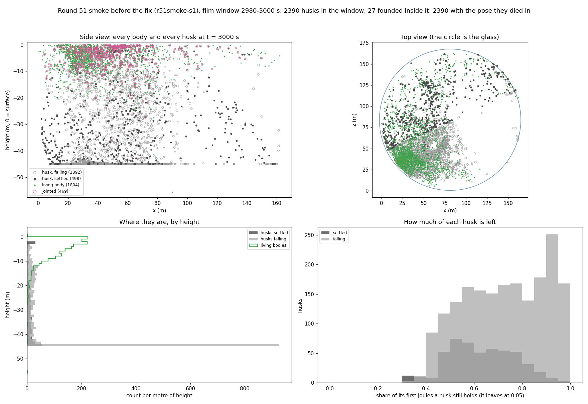
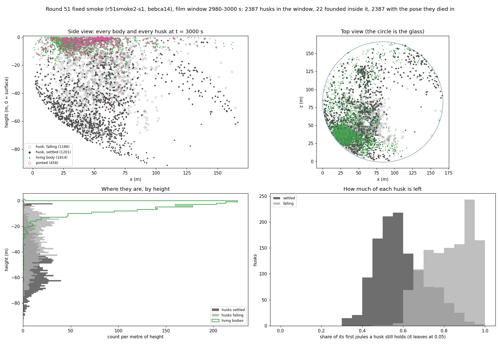

# Round 51's read: old bodies died holding their savings, and their husks lay all but uneaten

*2026-10-31, written by the writing lane from the committed read, about five weeks after round 51 ran on the night
of 2026-09-27. The pre-registration is logbook/0125, and the read is `logbook/specs/r51-read/final.txt`. The launch,
and the fault found the evening before it, are told in `logbook/specs/handoff-archive-2026-09-30.md`. Every figure is
measured unless it says otherwise.*

Round 51 brought two new rules into the tank. A body could now die of old age, and it died holding the energy it had
saved. Its dead body became a husk, which sank, settled on the bed or a reef, and dissolved over about half an hour.
Both rules did what they were written to do. Between 37% and 49% of the dead died of age, and every one of them still
held some savings. By the end the husks held about an eighth of the world's matter, a little more than all the living
bodies together. Three quarters of it lay still on the bottom, and almost nothing used it. One husk was eaten in each
of the three seeds in 30,000 s, and no line of pure eaters lasted, as the pre-registration expected. Joints went out
of two seeds in three. The matter books missed their bar by a few thousandths of a joule, and a probe traced that to
rounding in the burn.

## The owner ruled two ways to die, and a picture found a fault before the launch

Round 50 had no larder. Every body in it starved, so it died with its reserve at zero. The reserve is the energy a
body saves beyond what its tissue holds. A corpse therefore held its tissue alone, about 12 J, and four were eaten in
a run (D127).

On the morning of 2026-09-27 the owner asked one question first. It was whether corpses that hold only tissue could
feed an eater. The ledger, the project's calculator of what a body earns and spends, said they could not
(`logbook/specs/r51-husk-ledger.md`). Spread over the tank, such corpses put about 40 W into the water. Dissolved,
that comes to about 0.36 J/m³ over the bed. A still eater needs 0.44 J/m³ just to break even.

So the owner ruled both changes that day. Under D128 a body's chance of dying rises with its age, as Gompertz's law
has it for animals. The chance doubles every 600 s, and half of all bodies would be dead of age by 3,000 s on their
own clock. Each birth and each destroyed part pushes that clock on. The old wear of D038, which made an old body burn
its savings as upkeep, was switched off. An old body now dies holding its reserve.

Under D127 that body becomes a husk. A husk sinks at 0.05 m/s, 25 times as fast as the snow, the drifting dead matter
that the stomachs filter. It settles on the first reef top or on the bed below it. There it gives its joules to the
water with a half-life of half an hour. Two smaller rules came with these. A link, the part a joint moves, stopped
catching light, and a body's first small link became free to build and keep.

The pre-registration, logbook/0125, was committed that day. That evening the first film window with husks was drawn as
a plot. A film window is a stretch of a run recorded in full so it can be redrawn. This one came from the final smoke,
a short run of the round's own launcher on seed 1. It showed 621 of the smoke's 2,390 husks hanging at -45 m, and none
of them had settled.

The world's depth is the bed's mean, and round 51's bed tilts 96 m across the tank. Half of it lies below -45 m, down
to -93 m. The husk's drift stopped it at the world's depth before it tested for the bed. Over the deep half, a husk
hung in open water and never landed. The fix, `bebca14`, went in the same evening: a settling husk is now stopped by
the bed or a reef cap alone. A fixed smoke ran the same seed for 3,000 s. It settled 1,201 of its 2,387 husks, where
the first smoke had settled 498. They held 0.43 of the husks' joules, against 0.19. 0125 was amended before any seed
started, and logbook/0125 holds the amended text.

The two plots show the same second of the same seed, before and after the fix.

In the side view, a flat band of grey husks runs across the tank at -45 m. The height histogram below it has a spike
of over 900 husks a metre at that depth. Settled husks, the dark dots, are few: 498 against 1,892 still falling.

In the fixed plot the band is gone. The settled husks trace the sloping bed, from about -30 m on the shallow side to
about -90 m on the deep side. The living bodies, green, crowd the top 10 to 15 m, with the 458 jointed ones ringed in
pink. The histogram at the right shows most settled husks already down to 0.3 to 0.65 of their first joules, and most
falling ones above 0.6.

Reading this weeks later, I notice that the numbers had looked fine. A larder stuck halfway down still reads as a
larder in a table. It took a picture to show it hanging in the water.

## The three seeds ran overnight, and each reached its end

The owner gave the word, and the queue started at 22:23 on 2026-09-27. It ran the three seeds one after another, each
for 30,000 simulated seconds on sixteen of the processor's threads. Seed 1 took 123 minutes, seed 2 took 121 and seed
3 took 174, at 4.09, 4.12 and 2.87 times real time. The queue ended at 05:25 the next morning. Every seed ended on its
budget, and nothing diverged. The resume check from seed 1's checkpoint at 15,000 s matched the run on all 100 shared
samples.

## Up to half the dead died of age, and each held its savings

At 30,000 s, 19,155 of seed 1's 38,974 dead had died of age, a share of 0.49. Seeds 2 and 3 gave 0.37 and 0.41. Every
aged body died with a reserve, a median of 41 to 44 J. No starved body did, as the rules require. The aged died at a
median of 2,317 to 2,572 s. The starved died far younger, at a median of 369 to 672 s.

Those medians sit below the 3,000 s that the hazard alone would give. A birth pushes the clock, and two thirds of the
aged had bred. No part was destroyed in any seed, so the wound's push never fired. Yet the childless, whose clocks
nothing pushed, died of age at a median of 1,943 to 2,131 s. So the pushes are not the whole reason, and I don't know
the rest. One guess is that hunger takes some long-lived bodies before age can, which would pull the median of the
aged down. The read does not test it.

In every seed, bodies with more children died older. In seed 2 the aged with no child died at a median 1,943 s. Those
with one or two died at 2,564 s, and those with three or more at 2,757 s. 0125 warned that this reading is tangled. A
body that breeds more is pushed on further, but it is also a body that lived long enough to breed.

The hazard shortened life across the crowd. The mean age of the living at the end was 1,190 to 1,331 s, against 2,117
to 2,223 s in round 50's same seeds. The crowd was smaller too: 3,918 to 5,648 alive at the end, against round 50's
6,132 to 9,917.

## The dead came to hold more matter than the living, and it lay still

The table compares what the husks held at 30,000 s with what the living held. A unit of matter is worth 100 J. Look at
the third and fourth columns: in every seed the dead held a little more.

| Seed | Husks standing | Husks, units | Living bodies, units | Snow, units | Husks' share of the standing matter | Share of husk joules settled |
|---|---|---|---|---|---|---|
| 1 | 17,866 | 2,257 | 2,033 | 3,455 | 0.136 | 0.764 |
| 2 | 19,200 | 2,091 | 1,993 | 3,578 | 0.125 | 0.783 |
| 3 | 25,626 | 2,402 | 2,377 | 4,012 | 0.144 | 0.733 |

The husks also left when they should. In each seed the count standing at the end lay between the deaths of the last
7,000 s and those of the last 9,000 s. Few settled on the reefs. The reef caps cover a quarter of the tank, but they
held only 0.07 to 0.11 of the settled joules, in 713, 1,081 and 1,013 husks. Most of the larder lay on the bed.

Almost none of it was eaten. One husk went in each seed, worth 0.52 to 1.66 units. No living body was eaten, and no
part was bitten off. A later read of seed 1, cited in D129, shows why. At 12,000 s the settled husks lay at a median
depth of 50 m, from 17 to 76 m. The founding rules read a body with a mouth as eating nothing, so they set each such
founder at a random depth in the top 12 m. Seed 1's 202 mouth founders landed a median of 6 m down, about 40 m above
the husks. Across the seeds they lived a median of 104 to 117 s, and not one bred (logbook/0127). No mouth in round 51
started anywhere near its food.

I wanted a picture of that gap, the crowd under the surface and the husks on the bed below, and none can be made.
Round 51's snapshots keep only each body's id and genome, and its positions files are gone. A frame would mean
restoring a checkpoint on round 51's own build, and on 31 October the coordinator chose not to rebuild it.

## No line of eaters lived on the larder

E3 asked for a line, the descendants of one founder, with ten living pure stomachs. A pure stomach has absorptive
tissue, which takes in the dissolved and drifting dead matter, and no tissue that catches light. The best line in each
seed held one, a founder that had landed in the last 401 s of the run. Seed 3 had grown one real line of pure stomachs
from a founder of the population floor at 9.5 s. It had 51 members over the run and held 17 at 3,000 s, and none was
alive at the end.

0125 expected this failure, because the ledger put the husks' dissolved larder under a still eater's break-even, once
the cell its own mouth empties is counted. The lines that did reach ten living in seeds 2 and 3 were something else.
They were leaves that had grown a stomach as a bud, and the stomach brought them under 1% of their income.

## Joints went out of two seeds, and stayed in the third

A link now earned nothing, though the first small one cost nothing either. 0125 bet that the joints would fall away.
Over the whole run, jointed bodies averaged 137, 546 and 118 in the three seeds, against 408, 1,625 and 436 in round
50's same seeds.

The children show it more plainly. In seed 1, 0.29 of the children born in the first 5,000 s carried a joint, and none
born in the last 5,000 s did. Seed 3 fell from 0.35 to 0.007. Seed 2 fell from 0.41 to 0.14 by 15,000 s, then rose to
0.20 and 0.17. It ended with 607 jointed bodies, against 7 and 38 in the other two, and 514 of them had a jointed
parent, round 50's level. I don't know what seed 2's joints did for their bodies, and no read has asked.

## The matter books failed on a rounding, and a probe found where

B1 asks the world's books to close. The energy audit stayed under 1.1e-4 J in every seed, against a bar of 0.1 J. The
matter residual is the gap between the matter the world should hold and what it does hold. It ended at +4.5e-5,
-6.3e-5 and -1.1e-5 units, against a bar of 1e-5. At 100 J a unit, that is one to six thousandths of a joule (my
arithmetic).

0125 had named the likely place in advance. It was the fields' float door, where a field of the water takes amounts in
single precision while the rest of the books keep doubles. On 2026-09-28 a probe branch counted what each float
dropped, and resumed seed 1 from 11,000 s to 17,000 s (`logbook/specs/r51-read/b1-probe.txt`). The residual climbed
2.78e-5 units over those seconds. The burn, which hands the matter a body spends back to the water, accounted for
2.73e-5 of it. Remineralisation added about 4e-8, and the husks' last instalments about 3e-8. The probe changed
nothing, since its residual matched the run at all 600 shared samples.

So 98% of the gap was the burn. The first guess had been remineralisation, and it was wrong. Why the burn's rounding
kept one sign for thousands of seconds in round 51, and not in round 50, is still not known.

## Clause by clause, 32 held and five failed

The first table holds the clauses round 51 added that carry a bar. Each prediction is copied from logbook/0125 without
its figures from round 50 and the screen. Look at the verdicts: E3 is the only one that failed, and 0125 expected it
to.

| # | prediction (0125) | seeds 1, 2, 3 | verdict |
|---|---|---|---|
| A1 | death by age takes a large share of the dead: `deathsByAge` is at least a fifth of `deaths` at 30,000 s, in 3 of 3 | 0.491, 0.374, 0.409 | held, 3 of 3 |
| A2 | at the ages the hazard was set for: the median age at an aged death lies in 1,500 to 3,500 s, in 3 of 3 | 2,317, 2,508.5, 2,571.5 s | held, 3 of 3 |
| A3 | the build does what the rule says (a check): every aged death row carries a reserve above 0, and `deathsByAge` equals the aged death rows at the last sample, in 3 of 3 | 19,155 of 19,155, 19,726 of 19,726, 25,801 of 25,801; none without a reserve | held, 3 of 3 |
| H1 | the husks hold a larder: their joules over ρ (100 J a unit) are at least a tenth of the standing matter at 30,000 s, in 3 of 3 | 0.136, 0.125, 0.144 | held, 3 of 3 |
| H2 | the larder lies still: at least a quarter of the husks' joules have settled at 30,000 s, in 3 of 3 | 0.764, 0.783, 0.733 | held, 3 of 3 |
| H4 | a husk leaves when it should (a check, from 9,000 s): the husks standing at 30,000 s number between the deaths of the last 7,000 s less every husk eaten and the deaths of the last 9,000 s, in 3 of 3 | 17,866 against 16,389 less 1 and 19,743; 19,200 against 17,362 less 1 and 21,913; 25,626 against 23,153 less 1 and 29,438 | held, 3 of 3 |
| E3 | an eater line lasts: at 30,000 s a line has ten or more living pure stomachs (birth row `abs` 1, `pho` 0), in 1 of 3 | best line 1, 1, 1 | failed, 0 of 3 |
| LK1 | the joints fall away: the mean count of jointed bodies over every sample to 30,000 s is below round 50's same seed's, in 3 of 3 | 136.65, 546.46, 117.745 against 408.009, 1,624.79, 435.631 | held, 3 of 3 |
| O1 | the world holds a crowd: alive at 30,000 s between 2,000 and 16,000, in 3 of 3 | 4,717, 3,918, 5,648 | held, 3 of 3 |
| S1 | the hazard shortens the life: the mean age of the living at 30,000 s is below round 50's same seed's at the same second, in 3 of 3 | 1,189.98, 1,270.33, 1,330.51 s against 2,222.57, 2,179.12, 2,117.1 s | held, 3 of 3 |

The second table holds the clauses carried from round 50, in 0125's short form, and four of them failed.

| # | prediction, in short | bar | round 51 | verdict |
|---|---|---|---|---|
| W1 | every founder that eats the snow and not the dissolved matter lands at or above its column's mean of the snow | 3 of 3 | no miss in seeds 1 and 2; one trickle founder in seed 3 at 0.3229 against 0.3286 | failed, 2 of 3 |
| W2 | a pool founder's first mouth reading over its landing density, the median in 0.02 to 0.3 | 3 of 3 | 0.174, 0.152, 0.162 | held |
| W3 | the landing cell over its column's mean, the median at least 1.6 | 3 of 3 | 2.16, 2.27, 2.10 | held |
| G1 | births paid from a gestation account | 3 of 3 | 2,583, 3,458, 3,716 | held |
| G2 | the share of gestating children lower in the last 5,000 s than in 3,000 to 8,000 s | 2 of 3 | 0.154 → 0.121, 0.171 → 0.104, 0.132 → 0.120 | held, 3 of 3 |
| G3 | accounts held at death at least a fifth of what was banked | 2 of 3 | 48%, 43%, 46% | held, 3 of 3 |
| G4 | banked, less held, per gestation birth at least 50 J | 3 of 3 | 63, 60, 59 J | held |
| C2 | no checkpoint waits, and 300 checkpoints | 3 of 3 | no waits, 300 in each | held |
| C3 | no starved body dies solvent (an aged body dies solvent by design) | 3 of 3 | none of 19,819, 32,969 and 37,353 | held |
| B1 | audit under 0.1 J, matter residual under 1e-5 units, nothing diverged, ends on its budget | 3 of 3 | audit at most 1.06e-4 J; residual +4.5e-5, -6.3e-5, -1.1e-5 units; nothing diverged; all on budget | failed, 0 of 3 |
| V1 | a faithful film window from the round's own checkpoints | one per seed | 15,000 to 15,020 s in each seed, faithful | held |
| V2 | the member check names nothing on seed 1's 15,000 s checkpoint, and a resume from it to 16,000 s agrees with the run | seed 1 | passed; identical on 100 shared samples | held |
| M1 | at least 100 births carrying a bud | 3 of 3 | 284, 572, 1,237 | held |
| M2 | at least three quarters of bud births built the bud | 3 of 3 | 100%, 97%, 92% | held |
| M3 | a line from a stomach bud on a leaf has ten living at the end | 1 of 3 | 8, 144, 143 | held, 2 of 3 |
| M4 | in each such line the stomach brings under 2% of the income | every seed M3 holds in | 0.7% in seed 2; 0.8%, 0.5% and 0.3% in seed 3's three lines | held |
| O2 | under 25,000 alive at every sample | 3 of 3 | at most 4,924, 3,958, 5,701 | held |
| F3 | no line rooted in a pool founder has ten living at the end | 3 of 3 | the largest 0, 1, 0 | held |
| P1 | the whole run at or above real time | 3 of 3 | 4.09x, 4.12x, 2.87x | held |
| EK1 | no founder has a child within 1 s of landing | 3 of 3 | none | held |
| EK2 | the cap's counters agree with the rows, and a one-part pool stomach is cut 17 to 18.5 J | 3 of 3 | counters agree; 17.755 J | held |
| EK3 | the one-part pool stomachs' median age at death above 300 s | 2 of 3 | 337, 321, 370 s | held, 3 of 3 |
| EK4 | at most a fifth of them breed, and those that do have their first child a median 10 s or more after landing | pooled | 1 of 63, its first child 81 s after landing | held |
| EK5 | all pool founders' median age at death above 300 s | 3 of 3 | 282.5, 276, 285.25 s | failed, 0 of 3 |
| X1 | the snow's patchiness at the end between 0.4 and 1.0 | 3 of 3 | 0.50, 0.59, 0.55 | held |
| LC | the header carries `leaves where they earn most`, and the clamp's pile-up is absent | 3 of 3 | token present, no pile-up | held |
| O4 | in the line with the most living at the end, the jointed share below its share at 16,000 s, where that line was a fifth jointed then | every such seed | no seed's line was a fifth jointed | not asked |
| S3 | a rigid stomach child dies young, median under 1,500 s, where ten have died | every such seed | seed 3: 1,806 s over 28; under ten dead in 1 and 2 | failed |

B1 is told above. W1's one miss was a founder from the trickle, the stream of random newcomers, that landed 1.7% under
its column's mean. EK5 asked the founders drawn from the stored pool of stomach genomes to live a median of over 300
s, and they lived 276 to 285 s. S3 failed in seed 3, the only seed where ten rigid stomach children had died. The
readings A4, H3, H5 and LK2 are told in the sections above. The rest of the readings are in the read file.

## What it changed

D128 had left one choice open until round 51 ended: the heritable lifespan or the water's thrust would come next. The
read found a larder that no mouth had been set near. On 2026-09-28 the owner ruled D129, under which a founder with a
mouth lands where the corpses lie. The same day D130 put the lifespan gene into the same round, now mutating. The
coordinator had recommended D129 alone, so that round 52's corpse numbers would compare directly with round 51's. The
owner chose both, and said one would be removed if the pair caused a problem.

The owner also ruled that the code and the records call a dead body a corpse from then on. Round 51's records, D127
and 0125 keep the word husk. Round 52 carried B1's fix as well: the burn, remineralisation and a corpse's last
instalment now hand the water its matter as a double. Its predictions are logbook/0127. The thrust waited, and
swimming toward a meal came in round 54 (logbook/0130).

The ledger check had said that round 51 would set the table, and that something else would have to bring an eater to
it. The round did the first half. I find it reassuring, reading the reads cold, that its one expected failure arrived
for the stated reason.