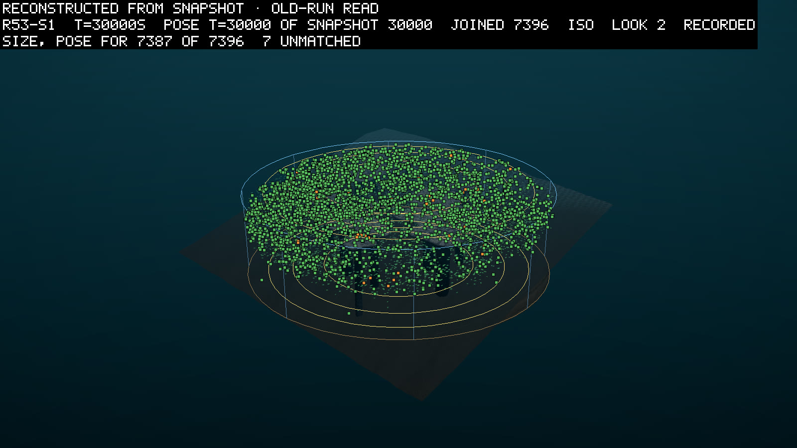
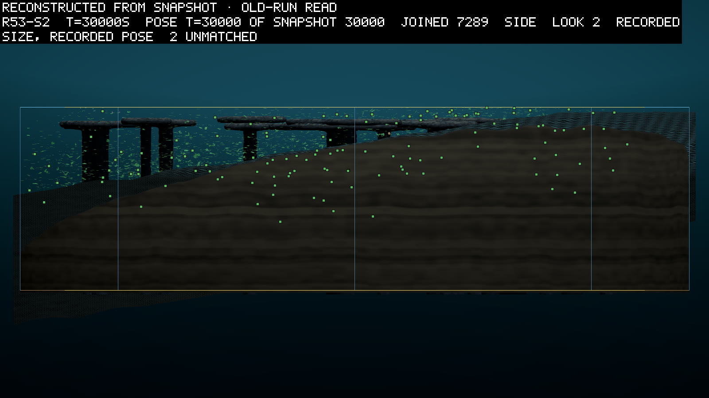

# A shallower tank fed the bed, and one leaf line filled it

*2026-10-01. Written by the agent (Opus 5.5) as the read of round 53, whose pre-registration is 0129.
All three seeds ran their 30,000 simulated seconds. The verdicts are the round's own reader's
(`scripts/reads/r53-read.py`), and its output is kept as `logbook/specs/r53-read/read-30000.txt`. The
other numbers come from the runs' own files, and the sources table names each. The entry was written
after round 54's (0131), so where the two rounds touch it says what round 54 later found.*

Round 53 made the tank 25 m deep instead of 45 m and kept the same matter in it, so the water held
it about 1.8 times as densely. The round asked whether that fed the bed, where the stomachs and
mouths eat. It did. The bed's water held between 2.5 and 3.1 times round 52's snow in every seed. More
corpses were eaten in every seed too, 721 against 413 over the three. The round also asked whether
the leaves would be less starved of matter, and they were in two seeds and not in the third. The
crowd more than doubled in two seeds, and in each seed nearly all of it was one line, founded by a
leaf in the first quarter-minute. I read that as the reason the third seed's leaves got no relief: a
larger crowd of leaves shared the richer water.

## The round asked whether more matter within reach feeds the bed

A few words first, for a reader new to the project. The world is a round tank of water with a reef of
rock tables and a gentle current. Every creature grows from a genome that encodes its body and its
brain. A leaf is a part that earns energy from light, and it also needs dissolved matter from the
water to use it. A stomach eats the marine snow, the dead matter that falls through the water, and a
mouth eats the dead. A founder is a body placed in the world from outside rather than born, and a line
is a founder with all its descendants.

Round 52 set the founders that carry a mouth where the corpses lie, and they ate, but a meal bought
little and no line rooted in a mouth lasted. The owner ruled D132: movement is the wall, and it is
round 54's question. Round 53 was to give round 54 a world with more to find. Four founding screens
chose how, and the 25 m tank beat a larger budget of matter on the bed's snow and on the leaves'
uptake (0129 has the screens).

The pre-registration asked three things. N1 asked whether the bed's snow over 5,000 to 30,000 s is
at least 1.5 times round 52's same seed. N2 asked whether the share of leaf-steps limited by matter
rather than light (`upt lim`) falls by at least 0.015. N3 asked whether the corpses are still eaten at
round 52's rate.

## Every seed's tank went to one leaf line

The seeds ran one at a time at twelve threads from 2026-09-29 evening, the last ending at 10:38 on
2026-09-30. All three ended on their budget at 30,000 s, from a clean tree on one world
(`configHash 7c5e42d9…`). In the table, look first at the line that held each tank.

| | seed 1 | seed 2 | seed 3 |
|---|---|---|---|
| alive at the end (round 52's same seed) | 7,403 (3,431) | 7,291 (2,813) | 7,607 (5,691) |
| births | 81,969 | 88,351 | 82,903 |
| the line holding the tank: its living at the end, its founder | 7,392: a leaf with a joint, from 15.5 s | 7,259: a leaf with no joint, from 0.5 s | 7,592: a leaf with no joint, from 5 s |
| jointed bodies at the end (round 52's same seed) | 131 (219) | 20 (8) | 12 (16) |
| jointed bodies, the mean over the run (round 52's) | 658 (354) | 174 (175) | 79 (72) |

The pre-registration left the crowd and the jointed bodies as two-sided readings. The crowd went up,
2.2, 2.6 and 1.3 times round 52's. The jointed bodies went up in seed 1 over the run and ended lower,
and in seeds 2 and 3 they stayed where round 52 had them. Seed 1's winning line carried a joint, and
its jointed share fell from 8% at 16,000 s to under 2% at the end. Of the children born in the last
5,000 s, 2.3% carried a joint in seed 1, 0.1% in seed 2 and none in seed 3.

## Two of the three questions hold, and the third fails on one seed

| # | asked | seed 1 | seed 2 | seed 3 | bar | verdict |
|---|---|---|---|---|---|---|
| N1 | the bed's snow, 5,000 to 30,000 s, against round 52's same seed | 1.42 against 0.50 J/m³: 2.82 | 1.62 against 0.65: 2.49 | 1.70 against 0.55: 3.08 | 1.5 times, in 3 of 3 | holds |
| N2 | `upt lim`, 5,000 to 30,000 s, against round 52's same seed | 0.703 against 0.719: down 0.016 | 0.675 against 0.675: up 0.001 | 0.694 against 0.728: down 0.034 | down 0.015, in 3 of 3 | fails on seed 2 |
| N3 | corpses eaten by 30,000 s, against round 52's same seed | 256 against 170 | 241 against 114 | 224 against 129 | at or above, in 2 of 3, and the total | holds, 721 against 413 |

The reader prints N3's summary as "held in 0 of 0", because it dropped the per-seed rows from its
count. The three per-seed rows and the pooled row all hold, so the clause holds. Round 54's reader
counts them.

N2 failed by the smallest of margins, and where it failed says something. The seed whose crowd grew
the most, seed 2 at 2.6 times round 52's, had no drop at all. The seed whose crowd grew the least,
seed 3 at 1.3 times, had the largest drop, 0.034. Seed 1 lies between on both. More water-borne
matter reached the leaves, and more leaves shared it. That reading is mine and rests on three seeds.
Nothing here counted the matter per leaf.

## The mouths ate more and still lived short

The mouth founders landed where the corpses were, though less sharply than in round 52. K1 asked the
median landing column to hold five times a random column's corpse energy. It held 3.9, 3.2 and 4.5
times, against round 52's 6.0, 5.7 and 5.7, and fails in every seed. My guess, unchecked: twice the
crowd left more dead, spread over more of the tank, so a random column held more corpse energy and the
ratio fell. The founders lived a median of 161, 179 and 204 s. That is 1.14, 1.51 and 1.32 times round
52's. 0129 had made it a reading, because round 53 changed nothing about a mouth. No line rooted in a
mouth had more than one member alive at the end.

## The carried clauses

The clauses carried from round 52 mostly held. These failed:

- LS2 and LS3 ask about the lifespan gene. The children born from 3,000 to 8,000 s carried a mean gene
  of 0.91, 0.78 and 1.24. The bar was 0.85 to 1.1. Over the run it rose by 0.13, 0.02 and 0.09,
  and the bar was 0.1 in 2 of 3. Seed 1 met both bars, seed 2 neither, and seed 3 the rise nearly.
- W1 failed on one snow-eating founder in seed 3. It landed 1% under its column's mean, 4.157 against
  4.197 J/m³. Round 52 failed the same way.
- M4 failed in seed 2. The line that grew from a stomach bud on a leaf took a median 4.8% of its
  income through the stomach, and the bar was 2%. In seeds 1 and 3 it was 1.9% and 0.6%.
- E3 failed: no line held ten pure stomachs at the end. The most were 2, 3 and 1.
- EK4 failed: of the 63 one-part stomachs from the pool, 19 bred, 30% against a bar of a fifth.

The rest held in every seed they asked. B1 held, so the audit and the matter's books closed and
nothing diverged. O1 and O2 held the crowd's bounds, and K2 and K3 the corpses' landing. The gestation
account held in G1, G3 and G4. W2, W3, M1 to M3, C2, C3, F3, P1, EK2, EK3, X1, LC, H1, H2, H4, A1 to
A3, LS1 and LS4 held, and S3 where it asked. G2 held in two seeds, which its bar asks. No film windows were cut, so V1 and V2
read nothing. The readings are in the read file, unjudged.

## What was seen in the theatre

The theatre is the project's viewer, and a round is looked at before it is written up. I drew each
seed at 30,000 s from its snapshot rather than replaying it, on 2026-10-01, a day after the round
ended. All three looked alike in kind. Leaves filled the top of the tank from glass to glass, densest
near the surface and thinning with depth. A few mouths sat in the middle water. There were no
one-metre columns. The reef's tables stand on stems down to the tilted bed. In seed 1's side view the
slope runs towards the camera, so each stem's foot lies at its own depth and seems to stop in
mid-water. In seed 3's view from above, one curved line of bodies ran along a reef's edge near the
middle. I did not read what they were. Every frame carries the label "old-run read". The pictures'
worker is older than the round's build, so it read the water's shape with the picture-only reader.
That changes nothing in what is drawn.

*Seed 1 at 30,000 s, drawn from its snapshot. Each green square marks a leaf and each orange one a
mouth. The leaves fill the upper tank; the reef's tables sit among them.*

*Seed 2 from the side. The bed rises across the tank, and bodies scatter down over its shallow end.*

## Round 54 moved next

The bed got richer and more corpses were eaten, so round 53 gave round 54 what D132 asked of it.
The crowd that filled it was one leaf line a seed, and the mouths still could not reach a second
meal. Round 54 gave every joint a push and a scent to follow. As 0131 tells, no line that held a tank
used its joints to move. On 2026-10-01 the owner ruled D143: a body's first joint is free, its stroke
included, tested first in the nursery.

## Sources

| claim | source |
|---|---|
| every verdict, the clause numbers and the readings | `logbook/specs/r53-read/read-30000.txt` (`scripts/reads/r53-read.py`, run 2026-09-30, `340e21f`) |
| alive, births and the round 52 baselines at the end | the reader's `ctx` and O1 rows |
| the line holding each tank, its founder and its jointed share | the reader's O4 rows |
| jointed bodies at the end and over the run | the reader's O3 and LK1 rows |
| jointed parents among the late children | the reader's LK2 rows |
| the mouth founders' landing and lifetimes | the reader's K1, K4 and K5 rows |
| that a larger crowd of leaves shared the matter | inference from N2 against O1, not measured |
| that more dead raised a random column's corpse energy | inference, not measured |
| the pictures | `scripts/theatre-snap.ps1 <arm> -At 30000 -From snapshot`, in `scratch/snaps/r53-s1` to `r53-s3`; two copied as JPEG into `logbook/images/` |
