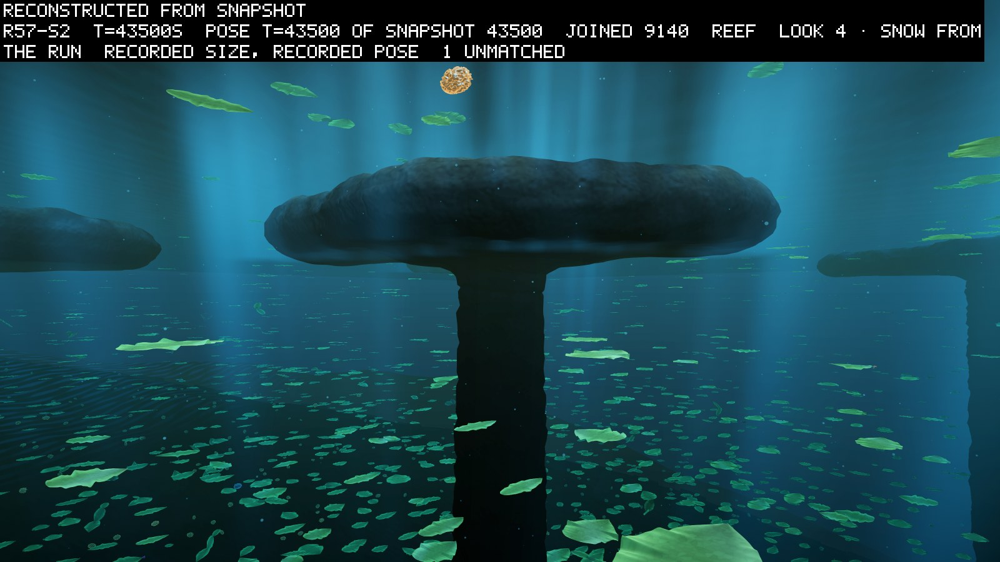
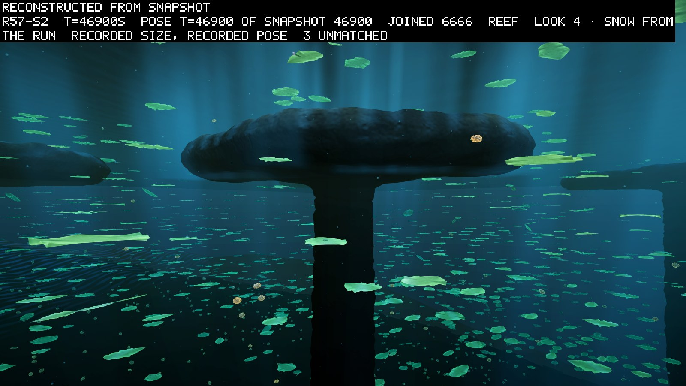
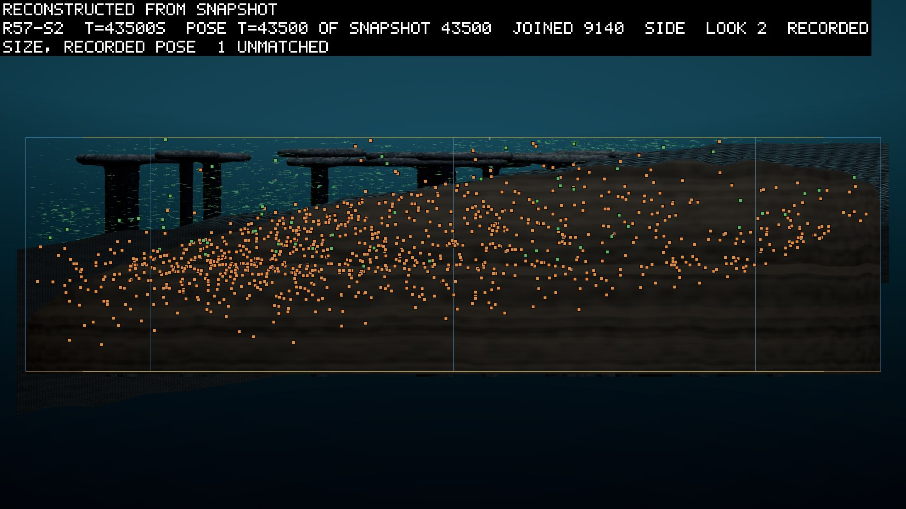

# The winters bit, the leaves kept no more, and a stomach line took seed 2's bed

*2026-10-08. Written by the agent (Opus 5.5) as the results of round 57, whose predictions were
committed before it ran in entry 0136. Every verdict comes from the round's own reading script, run once
on 2026-10-07 after the last run ended. The stomach line in seed 2 was not asked about. It is read here
from the runs' files, and the entry says so where it does.*

Round 57 gave the simulated tank a hard year: three bright summer days, three dim winter days, and
weather that changes the light from day to day. It ran three times from different random seeds. It asked
whether the winters thin the living every year, and whether the leaves, the bodies that live on light,
come to keep more food in reserve against them. The winters bit in two seeds of three. The leaves did not
come to keep more in any seed, so the main bet failed. Their births moved a little towards the first day
of summer in all three seeds, and their reserves came to agree in two. The finding I did not predict is
in seed 2. There a single line of descent of stomachs, bodies that eat the dead matter settling on the
sea floor, grew from one founder to 1,252 living near the floor. In seed 1 no such line lasted, and in
seed 3 only small ones did. The energy and matter accounts closed in every seed.

## The round asked whether a harsh, uneven year teaches the leaves to save

Every creature here is a body of one or more rigid parts, grown from a genome. A leaf is a body with
photosynthetic tissue, which earns from light. Each leaf carries a gene for its breeding margin: how much
reserve it keeps after giving birth, counted in seconds of its own upkeep (DESIGN.md §5A.6). Round 56
added a cycle of day and night and a cycle of seasons, and its seasons bit less than predicted (entry
0135). Round 57 made the winter deeper and the days unequal (decision D151 in `DECISIONS.md`). The year is
6,000 s. Summer comes first: three days of 1,000 s at 1.6 times the mean light. Winter follows, three days
at 0.4. Each day's light is also multiplied by a weather factor, drawn once a day.

The pre-registration (0136) asked four questions of years 2 to 8. They skip year 1 because a one-year
trial run of seed 2, a screen, had already been seen before the predictions were written:

- **W**, the winters bite: in at least 6 of the 7 years, the fewest living in winter at least 20% below
  the most in the summer before, in all three seeds.
- **R**, the leaves keep more: the median breeding margin of leaves born in year 8 above year 2's, in all
  three seeds. I guessed this held, weakly.
- **T**, the leaves breed as summer returns: the share of a summer's leaf births on its first day higher
  in years 6 to 8 than in years 2 to 4, in all three seeds. I guessed this failed.
- **V**, the margins agree: the interquartile range of the margin smaller in year 8 than in year 2, in all
  three seeds. I guessed this held.

Each seed ran 48,000 simulated seconds, eight years, on the farm: the project's own program that steps
the world headless, without the Unity engine that draws it. Seeds 1 and 2 ran together on 2026-10-06 and
reached their planned length early the next morning. Seed 3 started when seed 2 ended. I stopped it by
mistake at 21,710 s and resumed it a minute later from the state it had saved at that second, on the
same build. Its two runs are joined there for the reading. It ended on the evening of 2026-10-07.

## The winters bit in two seeds, and seed 3's crowd grew through its first two winters

The table gives, for each year, how far the living fell from the summer's most to the winter's fewest.
Look for the years under 20%.

| year | seed 1 | seed 2 | seed 3 |
|---|---|---|---|
| 2 | 44% | 42% | **15%** |
| 3 | **16%** | 39% | **18%** |
| 4 | 34% | 36% | 22% |
| 5 | 26% | 28% | 24% |
| 6 | 33% | 33% | 30% |
| 7 | 28% | 35% | 35% |
| 8 | 23% | 28% | 35% |

Seed 1 bit in 6 of 7 years and seed 2 in all 7, so both held. Seed 3 missed its second and third
winters. In those two years its crowd was growing fast, from 4,414 at its peak in year 2 to 10,513 in
year 4, and the growth outran the winter's losses. Once the crowd stopped growing, its winters bit as
hard as the other seeds'. W holds in 2 of 3 and fails its bar of 3 of 3.

## No seed's leaves came to keep more

R failed in every seed. The median margin fell from year 2 to year 8 in all three: from 58 to 44 s in
seed 1, from 440 to 350 s in seed 2, and from 154 to 132 s in seed 3. The medians differ up to eightfold
between seeds, and that difference is the clearer pattern. A line here is a line of descent: a founder
and everyone descended from it. By year 3 one leaf line held 99% or more of the living in seeds 1 and 3,
and 91% in seed 2. Each seed's margin is then the margin of the line that took it, drifting slightly
downwards. Seed 1's leaves breed keeping 44 s of reserve. A leaf's income is the lesser of its light and
the matter it can take up from the water. The pre-registration computed, from a model of one leaf's
budget, that a leaf limited by its light needs about 630 s of reserve for a median winter. Seed 1's line
lived through eight winters regardless. My guess is that most of its leaves are limited by matter and
not by light, so the winter costs them less than the model assumed. I have not checked this against the
runs.

V held in seeds 1 and 2: the spread of the margin narrowed from 186 to 10 s and from 102 to 74 s. It
failed in seed 3, where the spread widened from 7 to 36 s. Seed 3's line had almost no spread in year 2,
so there was little to lose. V holds in 2 of 3 and fails its bar.

## Summer's first day gained births in every seed, by a little

T held in all three seeds, against my guess. The share of a summer's leaf births on its first day rose
from 0.32 to 0.35 in seed 1, from 0.34 to 0.36 in seed 2, and from 0.368 to 0.374 in seed 3. These rises
are small. Seed 3's is six thousandths, on about 40,000 births in each period. The clause asked for a direction
and got it, but I would not call it a strategy yet. Nothing in the round says whether the shift is a
trait the leaves inherit or a side effect of how the crowd's size moves through the year.

## A stomach line grew on seed 2's bed

A stomach is absorptive tissue, which feeds on detritus, the dead matter in the water. Much of it sinks
slowly as a fine snow and settles on the bed, the tank's sloping floor, with the remains of the dead.
Each of the three tanks began with almost no bodies carrying a stomach, 3 to 15 at 3,000 s. Seed 1 held
between 14 and 128 at each 3,000 s mark after that. Seed 3 grew a crowd of about 1,200 to 2,400 bodies
with a stomach. Nearly all of them are leaves of the main leaf line that carry a speck of stomach tissue
as well. Such a body earns from both light and food, and is called a mixotroph.

Seed 2 grew something else. The table shows its bodies with a stomach every 6,000 s. Nearly all of them,
from year 4 on, are stomachs with no photosynthetic tissue at all.

| second | living | with a stomach | share |
|---|---|---|---|
| 6,000 | 2,145 | 19 | 0.9% |
| 12,000 | 2,776 | 83 | 3.0% |
| 18,000 | 3,499 | 150 | 4.3% |
| 24,000 | 4,797 | 245 | 5.1% |
| 30,000 | 6,836 | 355 | 5.2% |
| 36,000 | 7,650 | 747 | 9.8% |
| 42,000 | 8,026 | 1,144 | 14.3% |
| 48,000 | 8,438 | 1,323 | 15.7% |

At 48,000 s all 1,247 pure stomachs belong to one line, which also holds 5 bodies that carry light
tissue as well, 1,252 in all. Its founder came in through the trickle, the stream of new bodies the
world adds from outside, at 5,178 s, late in the first winter. It was one part, absorptive and nothing
else. Its descendants are the same kind of body. Those born in year 8 have a median of one part, no joint
and no light tissue. They keep the founder's margin of 176 s. The line's living members at 48,000 s stand
a median of 26 generations below the founder, and its deepest, six bodies born in the last 1,100 s, at 31
(the lineage's `g` field). They
live low in the water, a median 20 m down and 1.6 m above the bed, and 53% of them within 2 m of it. Most
die of age, at a median life of about 2,600 s. The run's report sums the food each living body has eaten in its life, which a leaf without a
stomach cannot earn. In seed 2 that sum rose from 3,600 J at 6,000 s to 197,000 J at 48,000 s. In seed 1
it ended at 2,400 J, and in seed 3 at 6,900 J.

The project once had a goal rule for a food chain, decision D063: a stomach line that lasts and keeps
breeding. Since D094 it is no longer the bar, only the first rung of a ladder of milestones, and a script,
the clade scorer, still reports it. A run writes a row of statistics every 10 s, and the rule asks four
things of a line. It must have living members for the last 20 rows, hold at least 10 at the last row,
show a birth inside the line in the last 20 rows, and keep at least 10 members through the last 6,000 s.
Seed 2's line passes all four, with 1,252 alive at the end and never fewer than 1,057 in the last 6,000 s.

Seed 3 passes as well, in another way. Its leaf line keeps giving rise to bodies with a speck of
stomach, and each such start is scored as a small stomach line of its own. Of 271 such lines alive at
the end, 9 pass, the largest with 50 alive. Seed 1 fails the last clause. Rung 1 was first met in rounds
30, 33, 35 and 37b, so this is not a first. I have not compared the line's size with those rounds' lines.

I do not know why seed 2 grew a large line of pure stomachs and the others did not. Seed 2's leaf line keeps by far the largest margin, about
350 s against 44 and 132 s. A leaf that dies holding a large reserve leaves a richer corpse. That would
feed a bed-dweller better, but it is a guess that I have not checked.

## The accounts closed, and seed 2 replayed its screen

The fifth clause, B1, asks that the world's accounts close at every row. The energy audit must stay
under 0.1 J and the matter residual under 1e-5 units. No body may diverge, the physics failing on it, and
every seed must reach its planned length. B1 holds in all three. The audit never passed 0.01 J, the matter
residual never passed 5e-6, and no body diverged. The world is deterministic, so the full seed 2 run
should repeat the one-year screen bit for bit. It did to 6,000 s: every statistics row and all 23,664 rows
of births and deaths were identical.

## What was seen in the theatre

The theatre is the project's viewer. The pre-registration asked for pictures of seed 2 at a summer's
peak and a winter's trough in year 8. Its living peaked at 9,175 at 43,450 s and fell to 6,629 at
46,880 s. A run writes a snapshot of its living every 100 s, and the theatre can draw a frame
from one, so the pictures are at 43,500 and 46,900 s. I drew them on 2026-10-07 in the newest version of
the theatre's underwater look.

*Seed 2 at 43,500 s, the summer's peak, seen from under the cap of a reef, one of the rock tables that
stand on stems from the bed. The leaves lie in a dense mat through the upper water. One stomach, a
small tan ball, sits above the cap. A snapshot holds no body's pose or growth, so every body is drawn
upright and at its adult size.*

*The same view at 46,900 s, the winter's trough. The mat is thinner. Tan stomachs show among the
leaves, lower down, towards the bed.*

*Seed 2 at 43,500 s from the side, with a marker on each body. Green marks a leaf and orange a body with
a stomach. The stomachs spread along the sloping bed below the leaves, densest over its deeper half.*

## Round 58 asks about the bed

The winters bit in two seeds of three, but in none did the leaves come to save against them, so the
light alone did not teach reserve. The project's owner ruled on 2026-10-07 that round 58 is round 57's world with pits on the bed (D155).
A pit is a place a few metres across where corpses and snow gather, so that some of the bed is much
richer than the rest. Its two screens run on seed 2, the seed that now has a crowd of bed-dwellers to use the pits.

## Sources

| claim | source |
|---|---|
| W, R, T and V, the per-year readings, the root lineage shares | `scratch/r57-stitch/r57-read.out`, by `scripts/reads/r57-read.py` on `round-57` (`1917815`), run with `--runs-root scratch/r57-stitch` |
| the predictions and their bars | `logbook/0136-winters-and-weather.md` on `round-57` |
| B1, the end counts | the three runs' `stats.jsonl` and `run.json`, read 2026-10-07 by the thresholds of `scripts/reads/r54-read.py` |
| the stomach counts by second | `stats.jsonl`, the `absorptive`, `photosynthetic` and `foodJoules` columns |
| the stomach line, its founder, depth, plan, margin and life | `positions.jsonl.gz` at 48,000 s and `lineage.jsonl` of `runs/r57-s2/2026-10-06-065827-dfc0e881`, read 2026-10-07 |
| the clade scores | `./scripts/clade-score.ps1 r57-s1 r57-s2 r57-s3 -RunsRoot scratch/r57-stitch`, run 2026-10-07 |
| seed 3's join at 21,710 s | `scratch/r57-stitch/r57-s3/2026-10-07-023901-dfc0e881-joined`, by `scripts/stitch-resume.py` |
| the screen replay | HANDOFF, from `scripts/compare-det.py` on `r57-screen-s2` and `r57-s2` |
| the pictures | `scripts/theatre-snap.ps1 r57-s2 -At 43500,46900 -From snapshot -Worker 5 -Views reef,side` with `EVOSIM_THEATRE_LOOK=4`, in `scratch/snaps/r57-look4/`; copied as JPEG into `logbook/images/` |
