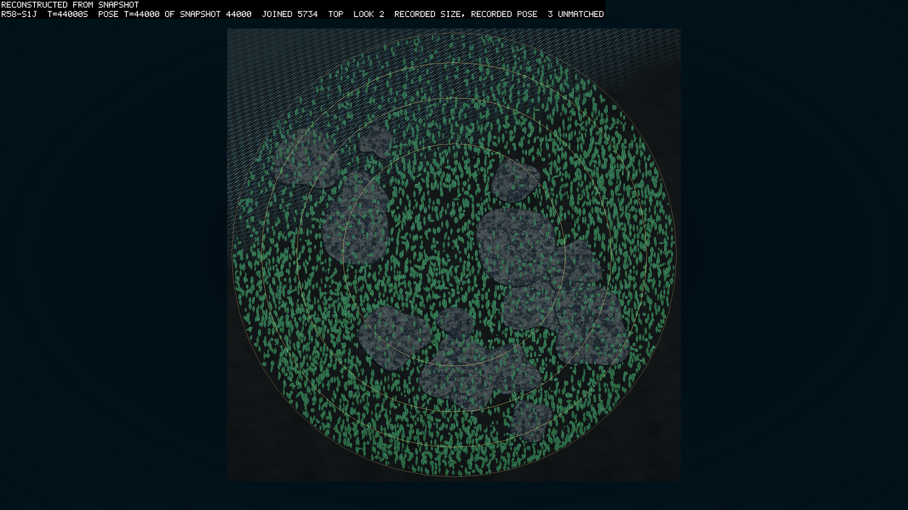
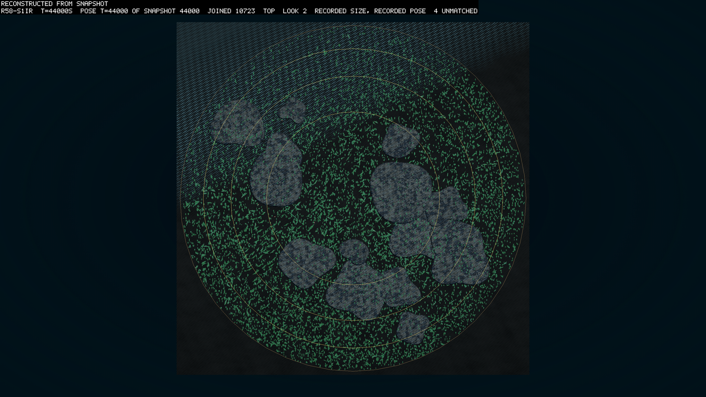
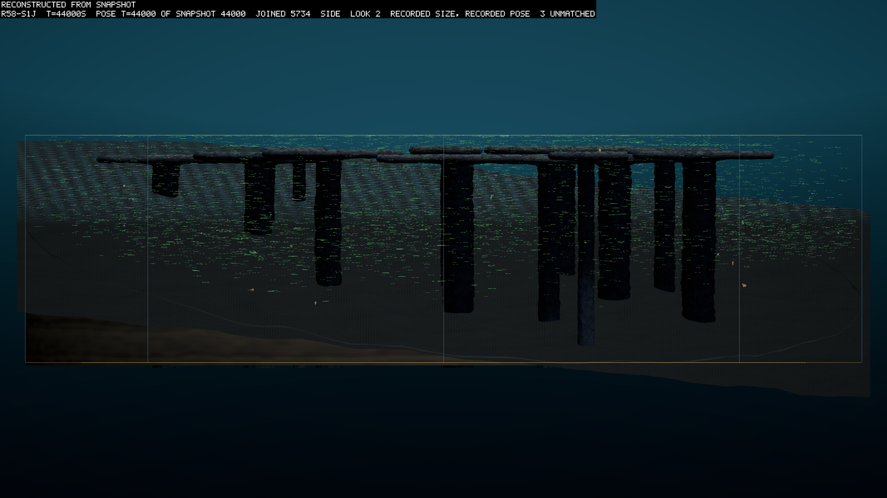
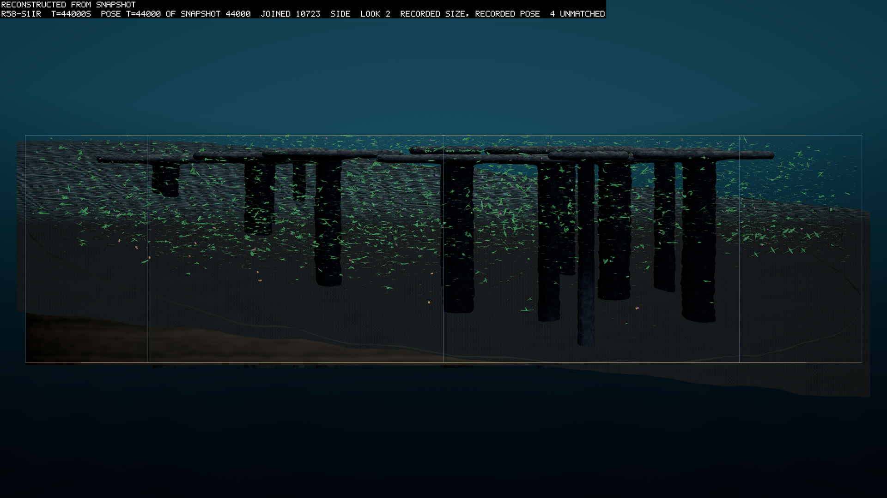

# Round 58's read: one line takes the ring

*2026-10-12, written the evening the round ended, against its pre-registration (logbook/0138, `r58-runner`
`141c97a3`). Every number says whether it is measured, computed or guessed. The reader's output is
`logbook/specs/r58-read/r58-read.txt`.*

## What happened

Round 58 joined three of round 57's worlds, seeds 1 to 3, in a ring that passed three genomes a world every
3,000 s. Three twins on the same seeds traded nothing. The joined group ran first, from 09:06 to 12:12 on
2026-10-12, at 4.34 times real time on the card.

The isolated group stopped itself at 12:23 on the card group's heat stop. The CPU read 91 °C for one sample,
against its limit of 90. Beside the group ran a read on every core by one of my subagents, and nothing
else of note, so the stop was mine. The worlds stood at 2,960 to 3,350 s. I resumed them from their common
1,500 s checkpoint as `r58-isor`, from 12:42 to 16:01, with nothing beside them. Over the overlap the resumed
worlds are byte-identical to the stopped ones in every file (measured,
`logbook/specs/r58-read/isor-overlap-compare.txt`). So each twin is read as its first run to 1,500 s and the
resumed run after it (`scripts/reads/r58-stitch-iso.py`). B2's resumed group followed, from 16:07 to 16:20.

## The predictions

| # | prediction | result |
|---|---|---|
| V | each joined world keeps more lines holding 1% of the living than its twin, in 3 of 3 pairs | **failed**, 2 of 3. Seed 1: 2 against 1. Seed 2: 3 against 1. Seed 3: 2 against 2 (measured) |
| S | a guild a joined world lacks after 6,000 s is later held by 20 or more arrival-descended bodies for a year | **unread**: no joined world lacked a guild at any sample after the first year |
| R | a guild that dies out in a joined world returns through an arrival | **failed**: jointed bodies fell to none in seed 2's joined world at 34,295.5 s and 40,738.5 s, and in seed 3's at 14,868 s, and no arrival brought one back |
| W | one founder's line holds over half the living in every joined world at 48,000 s | **held**: seed 3's floor founder 8 holds 99.5%, 78.0% and 98.4% (measured). I had guessed it fails |
| Y | the joined worlds' winter depths correlate more than the isolated worlds' | **held, weakly**: mean r 0.235 against −0.027, three pairs a group (measured). I had guessed it fails |
| B1 | the books balance in 6 of 6 | **held**: every world ended on its budget, the audit at most 0.0047 J and the matter residual at most 6.1e-6 |
| B2 | the twins match before the first exchange, and the joined group resumed at 45,000 s matches the unbroken one | **held**: before 3,000 s every file is the same but for the two exchange columns that only a joined world writes, and the resumed group is identical after 45,000 s |

B2's first half has one seam. Seed 2's first isolated run stopped at 2,960 s, 40 s before the first
exchange. So seed 2's twin was read against that run to 2,960 s, and against its resume from 1,500 s. The
resume first differs from the joined world at 3,000 s (measured, `logbook/specs/r58-read/twin-*.txt`).

## How the line took the ring

The rate came from a screen (`logbook/specs/r58-exchange-screen.md`). Over the screen's 12,000 s at three
genomes every 3,000 s, no world's arrivals held more than 4.2% of its living. The second year's slope, held,
reached about 26% by 48,000 s, so the rule picked that rate. The round's first 12,000 s replayed the screen's
group byte for byte (`scratch/logs/r58-join-vs-r58x2-12000.txt`). Then the share in seed 1's world climbed.

| world | 12,000 s | 15,000 s | 18,000 s | 21,000 s | 24,000 s | 36,000 s | 39,000 s | 42,000 s | 45,000 s | 48,000 s |
|---|---|---|---|---|---|---|---|---|---|---|
| seed 1 | 4.2% | 17.3% | 70.2% | 95.5% | 99.3% | 99.8% | 99.7% | 99.8% | 99.7% | 99.5% |
| seed 2 | 0.1% | 0.1% | 0.1% | 0.2% | 0.1% | 0.3% | 8.8% | 26.6% | 57.4% | 78.0% |

The table gives the arrival-descended share of the living (measured, the reader's samples). Seed 3's world
never passed 0.5%.

All of it is one line: the leaf line from seed 3's founder 8, which held 98.4% of its own world. It reached seed
1's world directly. In seed 1's world each later arrival of the line replaced the earlier ones. The clade
holding 91.2% of seed 1's living at the end was planted at 24,000 s, a 39th-generation copy. By then the line's
earlier arrivals already held 99.3%. Seed 2's world was taken at the second hop. Its winning clade was planted
at 36,000 s from seed 1's world, a 65th-generation copy of the same line (measured, lineage rows). Seed 2's own
lines keep 22%, a leaf line and its stomach line of about 740 bodies.

The screen's rule did not foresee this, and I set the rule. Taking over is not a slope that rises steadily. It
waits and then jumps, as the screen's faster rate X4 showed by 12,000 s. Two years of a slow rate showed only
the wait. I think a rule read on two years cannot bound a jump that comes in the third (inference). The next
screen should run longer, or read where the jump begins.

## What the twins show

The isolated worlds are no richer in lines. At year 8's end one line holds 99.7%, 98.2% and 84.3% of
their living (measured, the reader's yearly table), as in round 57. So V's two passes are arrivals adding lines to worlds
that a single line holds either way. They do not show variety kept.

Seed 1's twin is the round's most crowded world, with 8,792 living at the end against its joined world's 5,391
(measured). It also carries 307 jointed bodies against 9 (measured, stats). The pictures show the difference at
44,000 s, in year 8's summer.

The joined world's leaves are one shape, flat lenses lying flat and nearly all pointing one way. The twin's mix
round discs with long thin blades at every angle. Neither world has a crust at the glass or a column. The leaves
fill the disc between the reef caps. The deep third of the water over the bed is nearly empty in both, more so
in winter, and a few stomachs lie near the bed.

The video agent's count from the positions puts the twin at 10,723 bodies and the joined world at 5,734 at
44,000 s. The median leaf depth is 13.2 m and 11.8 m in summer, rising 3 to 4 m in winter (measured,
`scratch/snaps/r58-y8/README.txt`). The uniform leaves fit one line holding the joined world, and the reader
says seed 3's line holds 99.5% of it.

## Caveats

Seed 1's twin dropped contacts on the card. `r58-s1ir` failed card-run-check on overflow. Each body's list of
candidate contacts has a fixed size on the card, and the CPU's has none (`gpu-full-step-spec.md`). In this
world the lists filled, and 42,609 candidates were dropped over the run. The other five worlds read 0. The
count is a whole-run total, so the speed agent resumed the world on the card span by span, each span alone
(`logbook/specs/r58-read/overflow-spans.txt`). Every span to 42,000 s read 0. The drops begin between 42,000 and
43,500 s, which hold 4,232 of them, and the other 38,377 fall after 43,500 s. They begin as the crowd passes about
9,500 bodies and rise steeply with it (inference). So seed 1's twin is a world only the card made in year 8 alone,
and the pictures above, at 44,000 s, show that world.

No verdict turns on it. V fails on seed 3's pair whatever seed 1's twin reads. Y uses year 8, so I read it again to
the end of year 7, before any drop (`scripts/reads/r58-y-cut.py`, `logbook/specs/r58-read/y-to-42000.txt`). The
joined mean r is 0.327 against the isolated mean of −0.111, so Y holds there too, more clearly (measured). The
reader's figures at 48,000 s stand as recorded, and they include the card's year 8.

The rate was chosen on the round's own first two years. The joined group replayed the screen's X2 group byte
for byte to 12,000 s, so the rate was read off the same worlds it was then applied to.

The gitDirty gate was checked by hand. The launcher read the manifest's top-level fields, which are blank,
rather than `source.gitDirty`. The speed agent read every manifest by hand, and each names `141c97a3`, clean.
The fix lands in its own commit.

The twins' heat stop was mine. A subagent of mine ran a read on all cores beside a card group. Since then
nothing of anyone's runs beside a card group.

## What I take from it

I guessed W would fail, because I had set the screen to keep the rate under swamping. It held in every world,
by the same line twice over. What the ring did here was spread one world's winner. The isolated worlds show no variety for the
ring to have kept, either. Whether a slower ring, or worlds richer in lines to begin with, would do otherwise
is a question for a later round.
