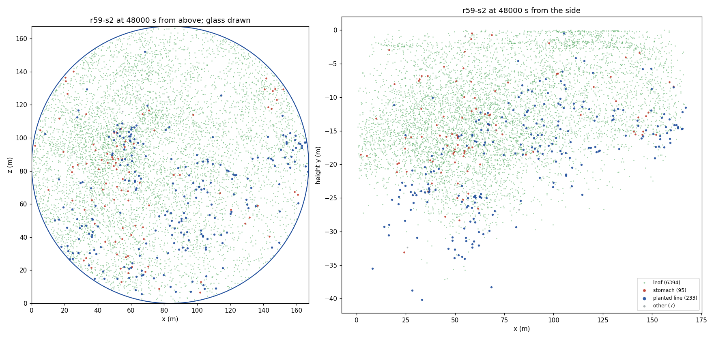
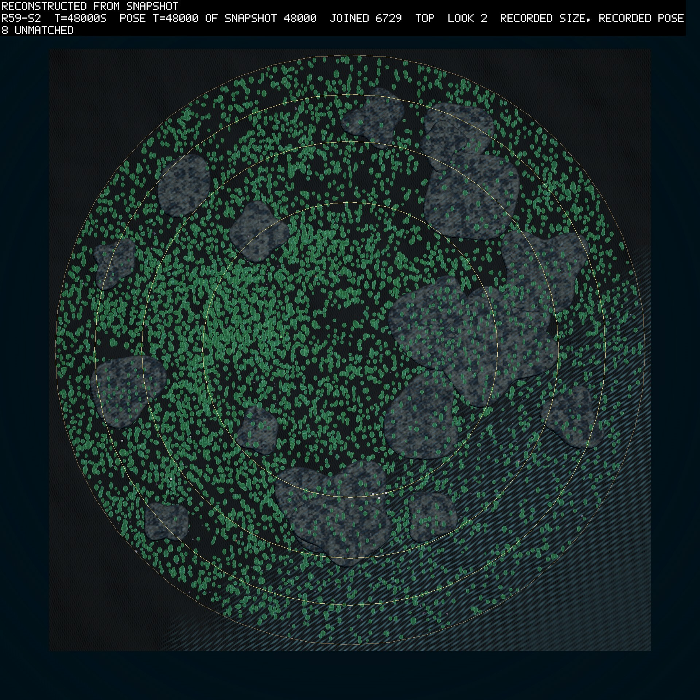
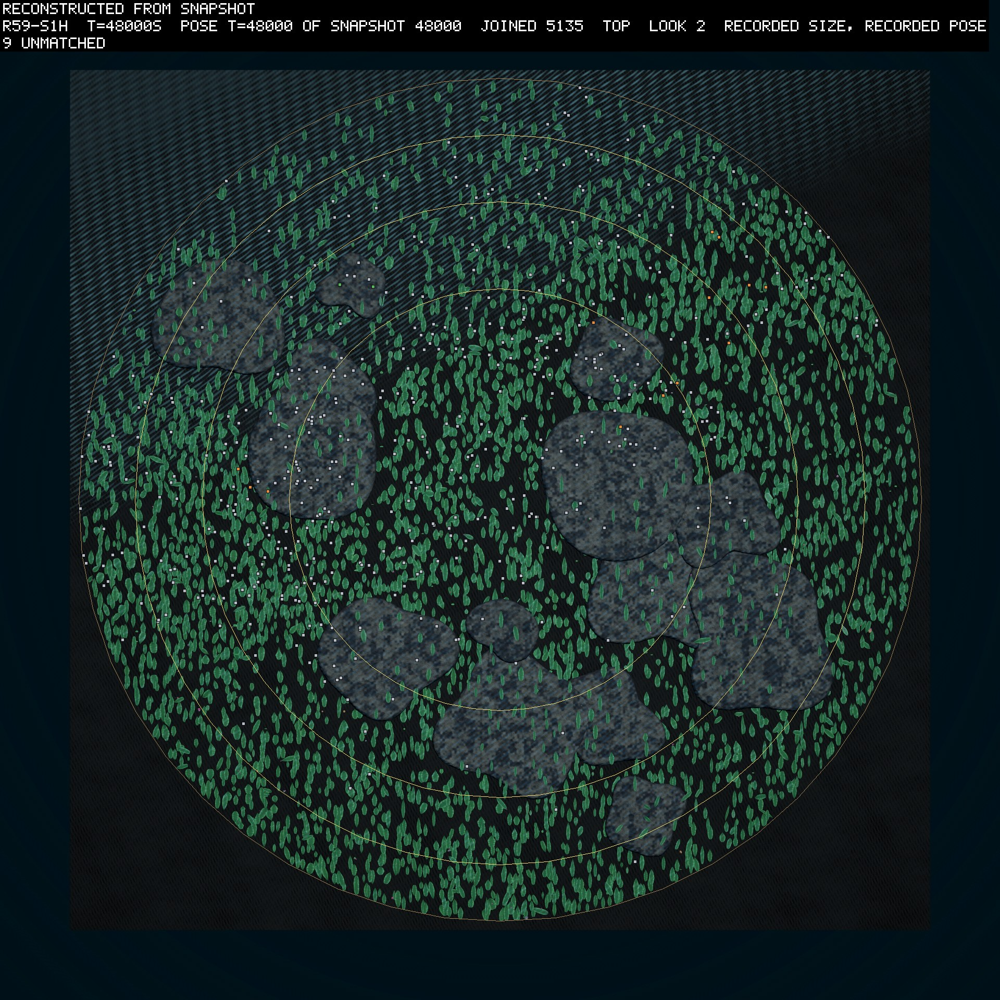
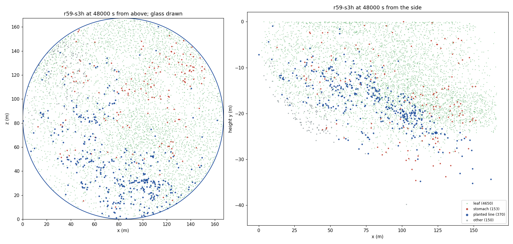

# Round 59's read: the planted grazers hold on, and the control grows its own

*2026-10-15, written the day after the round ended, against its pre-registration (logbook/0140, committed as
`c851d57c`). Each finding says whether it is measured, computed or guessed. The reader's output is
`logbook/specs/r59-read/r59-read.txt`.*

## What happened

Round 59 gave three of round 57's worlds the smell of their own leaves. Into seeds 2 and 3 it planted the ten best
leaf swimmers of the nursery, the small tank where swimmers are bred to a task. They came in through the
trickle, the stream of fresh founders that enters a world all round. Seed 1 got none and was the control. The
three ran together on the graphics card, as one card group, from 18:50 on 2026-10-14. A year here is 6,000
simulated seconds, and a round runs eight of them. "The living" counts every body, leaves included.

Seeds 1 and 3 stopped themselves at about 22:10, at 36,620 s and 41,840 s, on the card group's heat stop. The
CPU read over 90 °C for one sample, a few seconds after a short build began on two fast cores beside the group. Seed 2 ran on unbroken to 48,000 s. I resumed seeds 1 and 3 alone on the
card from where they stopped, as `r59-s1h` and `r59-s3h`, and both ended on budget by 01:20. The reader reads
each as one world: its first run to the stop and the resume after it.

Those resumes are not the unbroken worlds. B3 below found that a card resume of this build differs from the
unbroken run from its first second. So seed 1 after 36,620 s and seed 3 after 41,840 s are nearby continuations.
They are worlds the round's rules made, but not the ones the first runs would have gone on to make. Where a verdict
leans on them I say so.

## The predictions

| # | prediction | result |
|---|---|---|
| P1 | a planted founder has a child, in each of seeds 2 and 3 | **held**: 491 of 789 planted founders had a child in seed 2, and 436 of 742 in seed 3 (measured) |
| P2 | at least 20 planted-descended living at every sample for a year after 6,000 s | **held** in both: from 34,650 s to the end in seed 2, and from 29,380 s in seed 3 (measured). I had guessed it fails |
| P3 | at least 1% of the living descend from planted founders at 48,000 s | **held**: 3.5% in seed 2 and 6.9% in seed 3 (measured). I had guessed it fails |
| P4 | over half the planted-descended living are grazers, where P2 holds | **held**: all of them, 49 of 49 in seed 2 at 42,000 s and 142 of 142 in seed 3 at 36,000 s, the first year's end inside P2's year (measured). I had guessed it fails |
| G1 | at least 100 leaf kills a year by the control's own grazers, in 2 of years 6 to 8 | **failed**: 17, 32 and 33 (measured) |
| D1 | leaf kills over years 2 to 8 in each planted world at least 50 and twice the control's | **held**: 2,209 and 6,575 against the control's 95 (measured) |
| D2 | the planted lines steer by the smell, on the nursery's bench | **split**: held in seed 3, where the knockout cost 2.8 standard errors of eating, and failed in seed 2, at 1.6 (measured) |
| D3 | grazers that read the smell climb it more than those that do not, by 0.1 in mean cosine | **failed** in seed 3: 0.030 against 0.041. **Unread** in seed 2, whose non-readers counted 480 body-samples, under the 1,000 asked (measured) |
| D4 | the same for the control's own grazers | **unread**: one body-sample of a reader (measured) |
| C1 | the living at every year's end within half and twice round 58's means | **held** in 3 of 3, at 0.60 to 1.04 of them (computed) |
| C2 | one line holds over half the living by the end of year 3 | **held**: 98.3%, 72.3% and 99.3%, each a floor founder's leaf line (measured) |
| B1 | the books balance in 3 of 3 | **failed** in seeds 2 and 3, on matter alone: the residual drifted one way to −2.0e-5 and −1.7e-5 units, against a bar of 1e-5 |
| B2 | the card holds, with no contact candidate dropped | **failed** as written, on B1's matter and on the heat stops. The card itself held: no candidate dropped, no overflow, no divergence, no driver event (measured, `card-run-check.ps1`) |
| B3 | seed 2 resumed from 45,000 s matches the unbroken run | **failed**: it differs from the first second |

Seed 2 ran unbroken, and every P clause that held in seed 3 also held in seed 2. D2 held in seed 3 alone. G1 and C1 read seed
1's years 7 and 8 from its continuation. G1's year 6, before the stop, was already a sixth of its bar.

## How the swimmers held on

For thirty thousand seconds the planted swimmers lived the way round 55's had. The trickle brought in about
one a minute in each world. Three in five bred, most of them once, and their lines died with them. Between 15 and
25 of their descendants were alive at most samples. About four deaths in five were starvation, at a median age
near 900 s (measured, the reader's 1,500 s table).

Then in each world one line took off.

| seed | swimmer | its founders | its descendants born | its living at 48,000 s | took off |
|---|---|---|---|---|---|
| 2 | `direction-sparse-g15-36` | 63 | 3,142 | 221 of 235 planted-descended | after about 40,000 s |
| 3 | `direction-sparse-g33-30` | 82 | 12,399 | 358 of 370 | after about 31,500 s |

(measured, the reader's table by swimmer). They are different swimmers. Each other swimmer left at most four
living descendants at the end. The winning line in each world bred thousands, every one of them a grazer, and
three in four of its living at the end carried joints. Seed 3's planted-descended living rose from 35 at 31,500 s
to 552 at 39,000 s.

The leaf kills followed the line. In seed 3 they rose from 381 in year 5 to 2,693 in year 7. In years 7 and 8
about nine kills in ten were by planted descendants rather than by founders fresh from the trickle (measured).
That is a grazer breeding true in a world, which I had guessed would not happen.

Why the take-off came so late, I cannot yet say. The crowd had stood near 4,000 to 5,000 for years before it,
and nothing in the yearly table changes at that point but the planted lines themselves.

## The control's own grazers

Seed 1 had no planted swimmers, and from year 5 it grew mouthed grazers of its own: 28 at year 5's end, 134 at
year 8's (measured). They killed 13 to 33 leaves a year. That is under G1's bar of 100, but round 58's worlds
killed none in eight years. Grazing evolved here from the world's own founders, slowly, at D177's lower mouth
prices.

The control's leaves did something the planted worlds' did not. In its years 5 to 7, a fifth of the leaves born
carried armour, mostly on stems. In seed 3, under dozens of times the grazing, 1 to 3% did (measured,
`scripts/reads/r59-leaf-armour.py`). So in these three worlds the armour did not follow the grazing. It was commonest
where grazing was rare. Nor did
it protect much where grazing was heavy: in seed 3's year 6, 6.8% of armoured leaves were eaten against 7.7% of
the rest (measured). Armour here costs only upkeep (inference: cheap enough to drift up without a use).

## The smell

The planted swimmers were bred in the nursery to follow the leaf smell, and there the knockout cost them a third
of their eating. In the worlds, D3 asks whether grazers whose brains read the smell move along its gradient more
than those whose brains do not. They do not. In seed 3 the readers' mean cosine was 0.030 against 0.041. In every
year with a hundred samples or more, the grazers' mean cosine stayed under 0.16, so their motion barely followed
the gradient (measured, the recorder's rows).

The grazers sat nearer the leaves than chance did for most of the round, at 0.6 to 0.85 of a random point's
distance. At the end seed 2's still did (0.75), and seed 3's did not (1.1) (measured). By year 8 no point in these
worlds is far from a leaf. Seed 3 held about 4,600 leaves in the water at its year 8 samples, and a random point's
nearest leaf was about 3 m away (computed). A sense of direction pays little when food is everywhere. That reading is mine, and the nursery's
patchy tank is now testing it (D182, D184).

D2 asks the bench directly. It took the planted-descended genomes alive at 48,000 s, 227 from seed 2 and 362 from
seed 3. Each swam in the nursery's tank three ways: under its own brain, with no brain, and with the smell knocked
out. Without a brain they ate half as much or less. That was 10.2 J against 22.2 J in seed 2, and 4.4 J against
10.1 J in seed 3. Without the smell they lost little. In seed 2 they ate 20.1 J, a cost of 2.1 J at 1.6 standard
errors, under D2's bar of two. In seed 3 they ate 8.4 J, a cost of 1.6 J at 2.8 standard errors, over it. In both
seeds the knockout helped nearly as many genomes as it hurt. It hurt 111 and helped 109 in seed 2, and hurt 182
and helped 157 in seed 3 (measured, the nursery's registry entries 21 and 22). So the brains matter, and the smell matters a little, on average and not in every genome. In seed 3 that
average cost passed the bar in the tank, where leaves are few, though in its own world the grazers did not climb
the gradient (D3). I read that as a sense partly kept but not needed where leaves are everywhere (inference).

## The pictures

The theatre's frames at 48,000 s show leaves and reef caps, and no grazer. The planted swimmers live under the
leaf layer, at a median 17.4 m down in seed 2 against the leaves' 12.7 m. From above, the leaves hide them. From
the side, the near bed rises toward the surface and hides most of the water. So the speed agent drew where every
body is from the positions, coloured by the reader's own line rule.

The maps draw each body from the positions file. Their counts differ from the reader's table by two or three,
which I have not traced. In seed 2 the 219 bodies
of `g15-36`'s line spread over the south and the centre-west, with a looser knot near
the west glass. They are no nearer the glass than the leaves: 9% of each lie within 5 m of it (measured). From
the side they sit from 10 to 40 m down, deepest in the west, where the leaves sit deeper too. The 95 stomachs
lean west, among part of the line. The leaves fill the whole disc between the reef caps, densest in the centre
and west. A hatched patch on the south-east is, I think, the shallow bed's shore seen through the water
(unchecked).

The control looks the same from above: leaves everywhere, densest around the reefs. Its 136 grazers of its own
sit mostly in the west half, 16 m down, under the leaves, and a median 41 m from the glass (measured, the
positions).

Seed 3's line sits in the south half, 17.5 m down, with its densest knot near the south glass. Its 153 stomachs
keep apart from it, in the north-east. Against the north-west glass sits a cluster of bodies that are neither
leaf, stomach nor grazer, 150 in all, a fifth of them within 5 m of it. Nearly all, 142, are one line of the
world's own, founded from the trickle at 25,861.5 s. Its genome is a single consumer cell, with intake on and attack
off: a mouth that cannot bite. The line had 3,128 births (measured, `logbook/specs/r59-read/s3h-other.txt`). Its
founder landed by corpses, so I guess it lives on them, but the run keeps no row for a meal, and that is
unchecked.

## Caveats

B1 failed on matter alone. In seeds 2 and 3 the matter residual drifted one way, to −2.0e-5 and −1.7e-5 units
at 48,000 s. That is about a billionth of the world's 19,000 units. The control stayed near −2e-6. The audit of energy
held at 5e-4 J. The leading cause is the birth overhead's returned matter, which the world computes in single
precision (World.cs:5343). A planted line breeds near-identical children, so its rounding repeats with one sign,
where the control's varied births cancel (inference, `logbook/specs/r59-read/b1-drift.txt`). Round 60's build computes it in
double.

B3 failed, and it matters more. Seed 2 resumed alone from 45,000 s differs from the unbroken run from its first second, and so does
a resume from 1,500 s. The cause was the checkpoint: it did not carry the card's resting contact positions,
which the card has kept since D168. Every card resume from 2026-10-13 to round 60's build is therefore a nearby
continuation (`logbook/specs/r59-smoke/resume-survey.md`). Round 60's build carries them, and a resume from
1,500 s on that build now matches its unbroken run in every row.

The heat stops were the machine's, on a single hot sample beside a short build. The card group now waits for
two samples in a row at 90 °C (D183), and nothing starts on the fast cores beside a card group.

## What I take from it

I guessed P2, P3 and P4 would fail. They held, by one swimmer's line in each world, each a different swimmer,
each taking off after thirty to forty thousand seconds of dying out. A grazer bred in the nursery can found a grazing
line in a world. The world's own founders can make one too, slowly.

What the round did not find is a use for the smell. The grazers did not climb it, in a world where leaves were
everywhere. That is the question the patchy tanks now ask, in the nursery and in round 60's fed islands.
