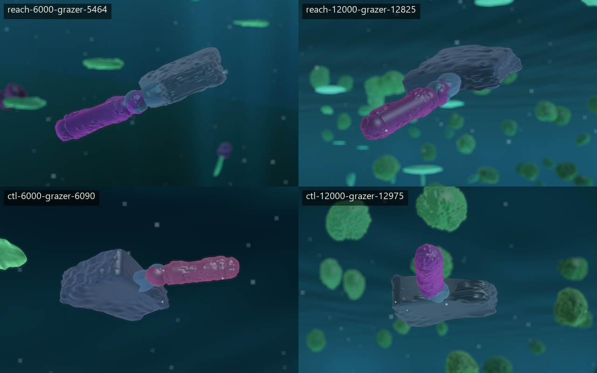
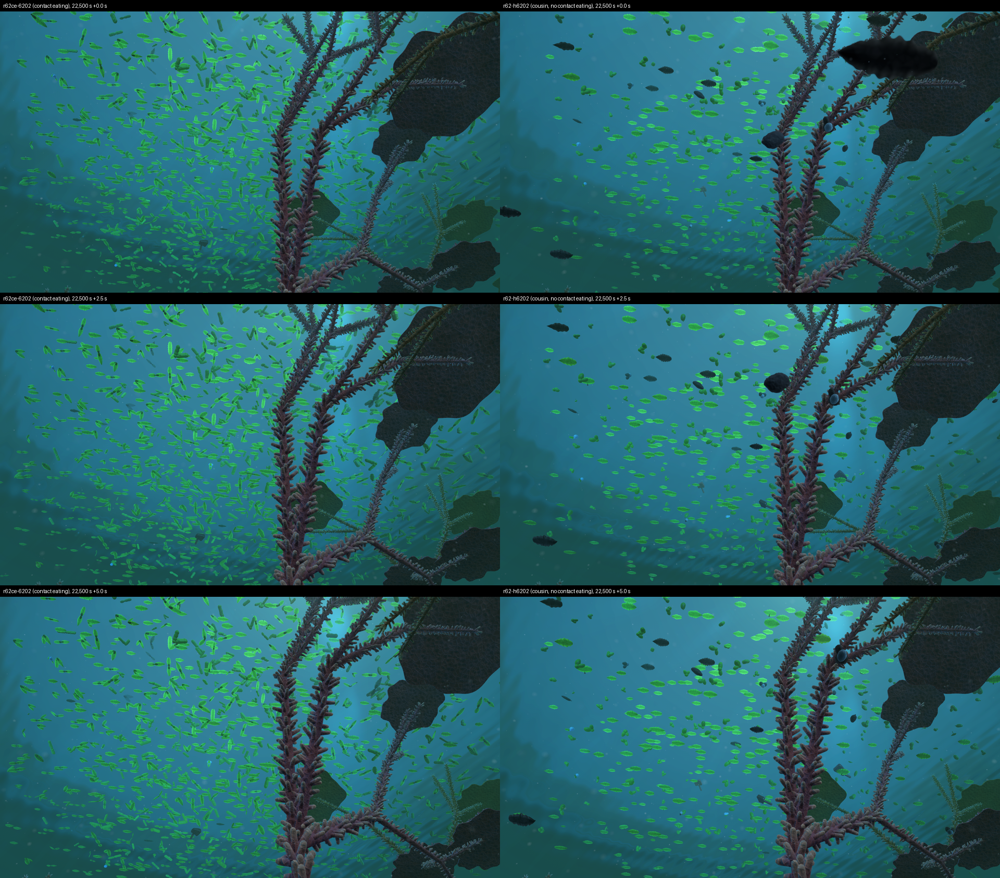
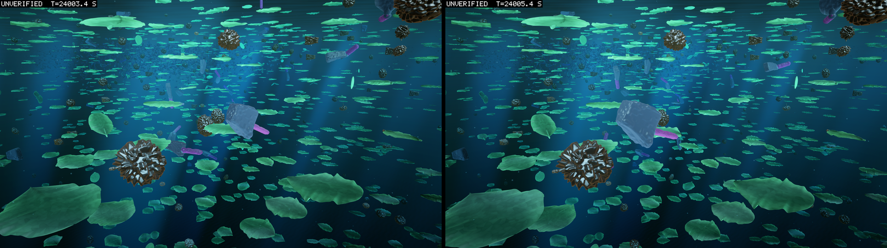
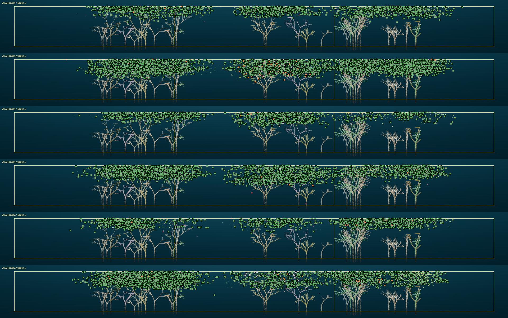

# Round 62 and its screens: grazers paid their way once they swam faster and grew up slowly

*2026-10-31, written by the writing lane from the committed reads, thirteen days after round 62's world was ruled
and four days after its last screen ended. Round 62's own read is `logbook/specs/r62-read/d215-table.md` on branch
`r62-launch`. Every other read is on main and is named where it is used. Every figure is measured unless it says
otherwise.*

Round 62 set out to grow grazers, animals that eat living leaves, in an open ocean of separate oases. It took ten days
and a dozen screens to find out why they could not. At first they lived on carrion, the corpses of leaves that died
near them. Then the owner ruled that a mouth may eat only what it touches, and that there are no corpses. The grazers'
income fell more than tenfold, and three larger dials on the bite did not bring it back. The meal was never the limit.
A grazer spent about 100 s finding each meal, and its budget allowed about 41 s. Two changes closed the gap. A limb
pushing sixteen times harder at a sixteenth of the price let grazers swim about three times as fast. And growth became
a slow climb to adulthood, so a newborn kept the reserve its first search needs. With both, grazers passed the
project's bar for a healthy guild on four seeds. They did not graze the oases bare, and almost none of them travelled
between oases.

## The open ocean, and a launch stopped in minutes

Round 61's tank had glass walls, and its crowds filled it (logbook/0145). On the evening of 2026-10-18 the owner ruled
a different world (D204, D205). It is a square of water 300 m a side whose edges join, so a body that swims off one
side comes back on the other. Island shoals sit inside it, with branching coral on them (D194). Matter is fed in at
the islands, and the open water between them is meant to stay nearly empty. Plants keep the matter their bodies are
built from (D206, D207), and a slow current of 0.02 m/s runs over everything (D209).

Six worlds launched on the graphics card at 16:53 on 2026-10-19. A world, here, is one founded run of the simulation
on one random seed, and the card runs several at once as a group. The owner stopped all six minutes later (D210).
Nobody had yet found settings that would keep a grazer alive. The round would have ended as round 61 did, with grazers
eating about a sixteenth of what they burned.

So the coordinator ran a screen instead, a short run of several worlds that each move one setting, read without
pre-registered predictions. A grazer in these entries is any body with a mouth. The seven worlds ran for 12,000 s that
evening, and one setting moved the grazers: the mouth's reach, the distance from which a mouth can feed on a corpse.
Raised from 0.5 m to 2 m, it let grazers breed 165 times against the control's 9. They met 0.80 of their upkeep, the
standing cost of being a body, against 0.16 (`logbook/specs/r62-grazer-screen/README.md`). Doubling the food in a
leaf, quadrupling the rate a mouth takes, and quadrupling a founder's starting gift each did nothing.

The pictures from that screen show what a grazer was. The theatre, the program that redraws a recorded world, drew the
mouthed body nearest a leaf at 6,000 s and 12,000 s in two of the worlds.

Every one is the same small animal, about 1.1 m long. A pink-purple rod, the link a joint moves, is hinged to a grey
block. The block is the consumer cell, and it is the mouth. Around them are leaves, the green discs, but none close
enough to touch. In those worlds 11 to 20 such bodies were alive at a time, among 1,300 to 1,700 bodies.

An overnight screen crossed the reach with how fast corpses spoil (D212, D213). At 3 m, grazers replaced themselves
for 24,000 s on seed 6201, whether corpses spoiled or not. Round 62 relaunched on that on the morning of 2026-10-23
(D214), as three pairs of twins on seeds 6201 to 6203. One twin of each pair had corpses that spoil with a half-life
of 500 s, and the other had corpses that never spoil. The pre-registration is
`logbook/specs/r62-prereg/predictions.md`.

## The round stopped on its own bar

While the round ran, the owner set a bar for a healthy grazer guild (D215), and then a rule for reading its third test
across worlds (D216). A guild passes when three things hold.

1. The guild keeps itself going: at least 80% of living grazers were born in the world rather than brought in as
   founders. One birth cohort replaces itself. A chain of mouthed parent to mouthed child reaches ten generations.
2. Grazers are alive at every season's end, and in the windows at the start of each summer they meet at least 0.9
   of their upkeep.
3. Grazers live by grazing, so the share of their intake from bodies they killed themselves rises over the run.

At 24,000 s the first test held in four worlds of six and the second in four, but both together in only two. The third
failed everywhere, because the share of grazer intake from their own kills fell in all six worlds. In the seed 6202
world with spoilage it went from 0.255 in the 12,000-15,000 s bin to 0.102 in the last. So the grazers were
scavenging. A dead leaf lay as a corpse for minutes or longer, within 3 m of several mouths, and whoever came by ate
it. The round stopped at 24,000 s that afternoon, as D215 said it would.

The coordinator's next guess was that fast rot would leave a kill's meat to its killer. A corpse gone in a minute has
no time to feed a passer-by. The fast-rot screen (D217, D218; `logbook/specs/r62-rot-screen/` on `r62-launch`) set
half-lives of 30 s and 120 s. The killers' share still fell, in five worlds of six. At 30 s its late value, 0.152 and
0.090, was no higher than the controls' at 500 s. A pair of worlds given half as much matter again at the islands ran
into the population ceiling of 25,000 bodies before 24,000 s, which ends a run.

## Eating by contact cut a grazer's income tenfold

That evening the owner ruled the change that shapes everything since (D219 to D222). A mouth eats only what it
touches. A biting cell feeds on the body it wounds as it wounds it, at most at the biting part's intake rate. No
corpse is made. A body that dies uneaten stays as limp remains, which can be eaten by contact until a time window
closes. D222 kept D215's three tests and changed the third to ask that most of a grazer's intake be living food.

The screen of that rule, `r62ce`, ran on 2026-10-24 (`logbook/specs/r62ce-read/README.md`). Its grazers killed leaves
about as often as the round's had. A kill now came with 24 to 31 J kept, against 398 to 434 J under the corpse rule.
Grazers kept 0.12 to 0.39 W against an upkeep of 0.908 W. In three worlds over 24,000 s, 1 to 5 grazers were bred,
against 711 to 4,727 in the controls. The leaves, with nothing cropping them, more than doubled.

The pair above was drawn on the morning of the read. The left column is the contact-eating world, and the right its
corpse-rule cousin on the same seed. Each is shown at 0, 2.5 and 5 s from 22,500 s, looking at the same oasis and the
same coral. On the left the water is thick with small green leaf bodies; the world held 14,472 bodies against 5,581.
On the right the leaves are sparser, and dark rounded bodies swim among them. These frames are faithful to the run at
their first instant and close cousins after it, because the theatre replays the card's world on the main processor.

The owner's direction was to push the eating dials until grazers were overpowered, then roll back, and the owner
delegated those steps to the coordinator (D223, D224). Three screens followed in two days, each a bigger lever.

The table shows what each did to the kept joules a kill and to a grazer's intake over its upkeep. Look at the last
column: a guild that pays its way needs 1.

| Screen | What it changed | Kept joules a kill | Intake over upkeep | Read |
|---|---|---|---|---|
| round 62, corpse rule | the control | 418-434 | 0.90-1.04 | `r62-read/d215-table.md` on `r62-launch` |
| `r62ce` | contact eating | 24-27 | 0.19-0.20 | `r62ce-read/README.md` |
| `r62cs` | a living bite also takes its share of the victim's reserve (D224) | 56-89 | 0.43-0.52 | `r62cs-read/README.md` |
| `r62bd` | the wound at 2, 4 and 16 times its depth (D226, D227) | 61-77 | 0.57-0.68 | `r62bd-read/README.md` |
| `r62kg` | a killer swallows what is left of its kill into a gut (D232) | 79-80 | 0.54-0.57 | `r62kg-read/24000/README.md` |

None of these screens passed D222. Nothing overshot, so nothing was rolled back (D225, D230). The deeper wound raised
income through more kills a second, 1.1 to 1.7 times as many, while the joules a kill stayed where they were. The gut
was the most telling. In its check run, two-thirds of kills came on the bite that took the victim's last tissue and
reserve, so a dead body held almost nothing to swallow. The gut changed where about 30 J went, and not how much. I
find that one oddly satisfying: a screen that was forecast to fail, for a stated reason, and failed for that reason.

## A meal took 100 s to find, and the budget allowed 41

On 2026-10-25 two design reads and a budget turned the question round. The kill-rule read
(`logbook/specs/kill-rule-read.md`) found that a grazer's mouth bites during about 0.5 to 1% of its life, and each
bite already takes a whole leaf part. The 420 J a kill under the corpse rule had never been one meal. It was carrion
that fed several grazers through the 3 m reach, all of it charged to the kill.

The budget (`logbook/specs/grazer-breeding-budget.md`) counted in the owner's terms of a pace of life. A meal takes
the time to find it plus the time to eat it, and a grazer has to earn two or three breedings in its life. A meal took
about 100 s, nearly all of it travel, against about 41 s allowed. Eating was some 2,000 times faster than it needed to
be. A bred grazer was born with 13.5 J and starved at a median of 15.5 s. The owner ruled that night that a mouth must
touch to graze, and that this would not change (D237). The next day the kill rule was kept as it was, and the 420 J
bar was retired (D238).

The pace-of-life read (`logbook/specs/pace-of-life-read.md`) then compared ways to give a grazer more time. Its
recommendation was a pace factor k: the number of physics seconds that pass in one world second. At k = 3 a body
swims, sinks and strokes three times as far for each joule of upkeep, and nothing in the economy changes. The cost is
wall time, about three times as much. The owner ruled on 2026-10-26 that two schemes be screened side by side (D239).
One was the pace factor at 3. The other was the thrust arm. It makes a limb push nine times harder at a ninth of the
price, so bodies swim about three times as fast on the ordinary clock. Both gave newborns half their share of the
parent's reserve instead of a fifth.

## Speed passed, the slower clock did not, and the newborns were still dying

The thrust arm, `r62p-t3`, was the first world in round 62 to pass D222. Its grazers met 1.54 times their upkeep. The
pace-factor arm failed test 1, with a born share of 0.50 and an intake over upkeep of 1.11. I had expected the two to
land together, since both triple a swimmer's reach per joule. I don't know why they did not, and no read has asked.

Half the bred grazers in the passing world still died young, and the newborn ledger found why
(`logbook/specs/r62p-read/newborn/README.md`). A newborn was born at 0.65 of its adult size. On its first half-second
step, growth spent 54% of its reserve making it adult-sized, and left it about 18 s of upkeep. The nearest leaf was
about 1.4 m away, ten seconds' swim at an adult's speed. Half the newborns barely moved in those ten seconds and
starved. Raising the newborn's reserve to half had bought almost nothing, because growth turned the extra into body at
once.

The owner ruled growth a climb (D241). A body grows over time toward adulthood, paid from its reserve, and only while
that reserve is above a threshold the body inherits as a gene. Two growth screens chose the climb's length and the
gene's starting value: 60 s to adulthood, and a threshold starting at 30 s of the body's own upkeep
(`logbook/specs/r62gr-read/24000/README.md`, `logbook/specs/r62gr2-read/24000/README.md`). Bred grazers then died at a
median of 60 to 64 s instead of 26.5 s. The share that never ate fell from about half to about a third.

The second pace group asked whether the thrust arm won through speed or through cheap swimming
(`logbook/specs/r62p2-read/24000-a/README.md`). The answer was speed. One world kept the ordinary push and cut its
price ninefold. It failed D222 as badly as any world in the round, at 0.72 of upkeep, and its grazers swam at the base
world's 0.07 m a world second. The other pushed sixteen times harder at a sixteenth of the price. It passed at 1.86,
with grazers swimming 0.18 to 0.26 m a world second.

The pictures show that world, `r62p-t16-6201`, at 24,003.4 s and two seconds later. The theatre lane replayed the card
run on the processor with build 7bdbfcc7, and the replay was not checked against the run, so each frame says
UNVERIFIED. The look also predates the skins the owner accepted. The grazer is the pale-blue block with a purple stalk
in the middle. In the second frame it has come in from the centre and is closer, among flat green leaves. Dark, spiny
bodies drift around it, and the water above is thick with more leaves.

Two more questions about the newborns came back empty. A screen of the rate of structural mutation, the changes to a
body plan between parent and child, found no rate that cut the share of slow newborns enough
(`logbook/specs/r62sm-read/24000/README.md`). A bench of the newborn's brain found that with the body held, every
brain settled to one fixed drive, and nothing at birth changed that (`logbook/specs/r62p-read/brain-birth/README.md`).
The owner ruled on 2026-10-27 that newborns that stand still are left to selection (D246).

## The settings held on three new seeds, and the grazers stayed home

The confirmation round, `r62cf`, ran on 2026-10-27 from 18:04 to 21:01 (`logbook/specs/r62cf-read/24000/README.md`).
It put the screens' choices on three new seeds. Those were the sixteen-fold push, growth as a 60 s climb, the
threshold gene starting at 30 s and today's mutation rate. That evening the owner amended D222 for runs aimed at
grazers (D244). A world must first hold 30 grazers, and a window with fewer is not judged. Every world passed, the
screen's seed included, at 30 grazers and at 40, and the three new seeds passed on the strict reading too.

| World | Grazers at most | Born share | Best cohort | Chain | Intake over upkeep |
|---|---|---|---|---|---|
| `r62cf-6202` | 141 | 0.908 | 1.03 | 25 | 1.64 |
| `r62cf-6203` | 87 | 0.812 | 1.10 | 34 | 1.86 |
| `r62cf-6204` | 112 | 0.946 | 1.01 | 18 | 1.70 |

The margins are thin in test 1. Seed 6203's born share is 0.812 against 0.8, and seed 6204's best cohort is 1.01
against 1.

The strips show each new world from the side, at 12,000 s above and 24,000 s below. Three groves of branching reef
stand on the bed. Far away the theatre draws bodies as tiles: green for leaves, orange for a body with a mouth. At
12,000 s a thin layer of leaves sits under the surface over each grove, with clear water between the groves. By 24,000
s the layers are two or three times as dense and reach further down. In seeds 6203 and 6204 the second and third
groves' layers have met, so the open water between those oases has closed. Below the leaves the water is nearly empty.
The orange tiles are few, and in seed 6202 most of them sit over the middle grove.

The grazers lived on their oases and almost never left. Under 1% of bred grazers ever moved between islands. A
crossing took a median of 140 to 230 s, and a grazer died at a median age of 60 to 67 s. So few lived long enough to
make one (inference). The leaves were never grazed down: age, not grazers, killed most of them in every bin.

## What it changes

The pace factor, growth as a climb and the threshold gene went to main behind switches (D243). The confirmation
round's world, with its sixteen-fold push, became the base for what followed. The owner chose fat, tissue that lets a
body store more reserve, as what should make a crossing between oases pay (D247), and its screen opens round 63.

Two things the round taught are mine to say. First, the corpse rule had hidden the grazers' real problem for a week,
because carrion within reach paid for slow searches. Second, grazers that pass the bar are not yet grazers that shape
their world. They hold no oasis down, and they do not travel. Round 63 asks about both.