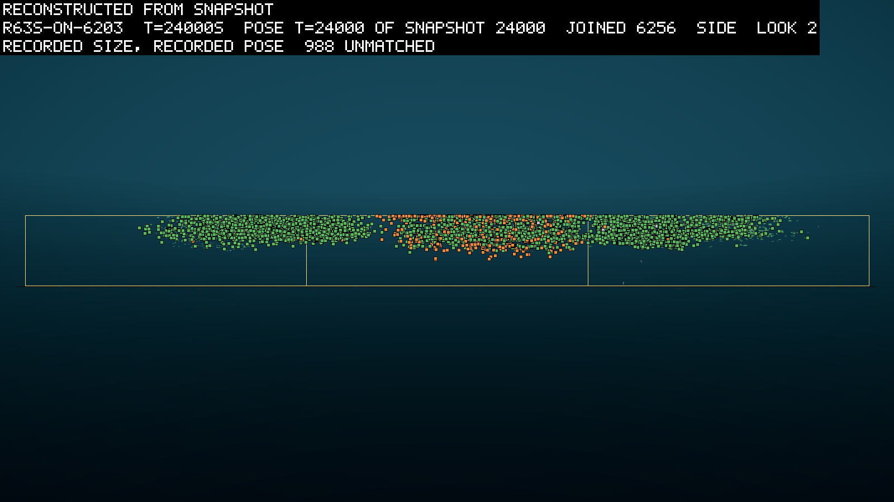
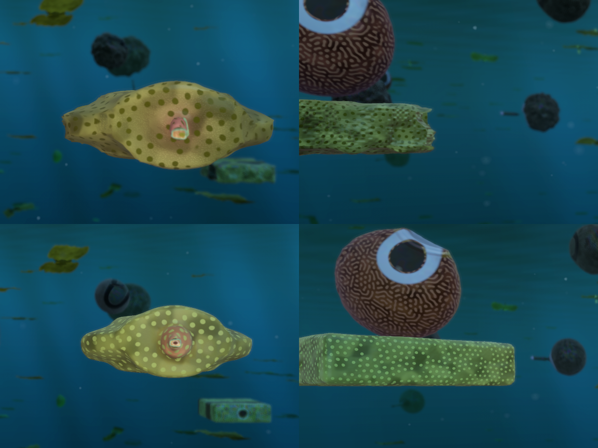

# Round 63: the film's world fills to the brim, and cheap mouths eat each other

*2026-10-31, written by the writing lane from the committed reads, one to three days after round 63's screens ended.
Each screen's pre-registration and read are under `logbook/specs/` and are named where they are used. Every figure
is measured unless it says otherwise.*

Round 63 was the first round aimed at a film. Its job was to find a world worth filming, in which grazers survive and
evolve. It found one, and then found two things wrong with it. First, the leaves grew without anything holding them
down, until three long runs of the chosen world each hit the population ceiling of 25,000 bodies and ended early.
Second, when the price of a mouth was cut to a hundredth, grazers became six to fourteen times as many and grazed the
leaves to a third of the control's. But by then more than half of a grazer's food was other animals, and grazers were
the main thing killing grazers. One mouth at one price makes a cheap predator as readily as a cheap grazer. Along the
way the shape family, a new set of limb shapes, passed its screen and joined the film's world.

## A film with gates

On 2026-10-28 the owner ruled that the work aims at one film of a grazer world (D254). The plan,
`logbook/specs/grazer-film-plan.md`, sets a series of gates, each a screen with pass marks, named G0 to G8. A feature
that passes its gate goes into the film's round without a further ruling, and one that fails is left out. The gates
ask three things of a world. Its grazers survive, by D222's tests and a floor of 30 grazers (D244). It evolves: some
inherited grazer trait shifts by at least one standard deviation of the founders'. And it gives a story of at least
five beats that can be filmed. Migration between oases is welcome but not required.

That morning the owner had also proposed islands that bloom on their own clocks (D251). Round 62 ended with grazers
that stayed home on their oases (logbook/0147). If one island's food surges while another's fades, a grazer has
somewhere better to go. Each fed island's influx, the matter that arrives there, now rises and falls on a slow cycle
of its own, with the world's total held constant. A blooming island can also be smelled from tens of metres away,
further than a single leaf.

## The bloom screen failed, and its rerun gave the film its world

The bloom screen, `r63b`, ran eight worlds on 2026-10-28: four arms on two seeds, 24,000 s each
(`logbook/specs/r63b-prereg/predictions.md`, read in `logbook/specs/r63b-read/README.md`). Arm A had no bloom. B had
the blooms alone, C the blooms and the far smell, and D added fat, tissue that lets a body store more reserve (D247).
Islands drew periods of 2,500 to 6,000 s.

No arm passed all three gates on both seeds. Most survival failures were one dip in grazer numbers between 9,000 s and
12,000 s, after which grazers grew to 75 to 130. The bloom barely reached the food. The leaves on an island were meant
to follow its influx at a correlation of at least 0.5, and they followed it at 0.1 to 0.4. Fat's arm never held 30
grazers in either world. Arm A's dip, the coordinator found, came from the energy sense, an input that tells a brain
how full its body's reserve is (D245). It cut births there by about a third.

The owner ruled the next day that the rerun would judge survival from 12,000 s, drop fat, and keep the energy sense
(D256). The rerun, `r63c`, slowed the blooms to periods of 5,000 to 10,000 s and ran B and C again on 2026-10-29
(`logbook/specs/r63c-read/README.md`). Survival passed everywhere. Half the islands now followed their bloom in B,
four and five of eight. Evolution passed on one seed. The far smell bought little: C crossed between islands only one
or two more times than B, and its leaves followed the bloom on fewer islands. I read that as the scent drawing grazers
off their islands and away from the leaves the bloom feeds, which is a guess.

No arm passed every gate, so the choice went to the owner, who took arm B as the film's world (D259): the slow bloom,
with the far smell off. It is the simpler world, and its leaves followed the bloom best.

## The shape family passed its screen

That night the shape screen, `r63s`, ran B's world on two seeds with the shape family switched on
(`logbook/specs/r63s-read/README.md`). The family (D233) adds a fourth part shape, a tapered rounded block whose
proportions are inherited genes. It comes with a fin law that pushes water by a limb's width across its swing (D229,
D255). The screen asked that grazers still survive, that family limbs appear in a tenth of jointed bodies, and that
moving grazers keep 0.8 of their speed.

It passed every gate on both seeds. At 24,000 s about a fifth of jointed bodies carried a family limb, 0.193 and
0.180. Moving grazers swam at 0.98 of their speed without the family. So the family and its fin law go into the film's
round. The read is careful about what that means. Few grazers carried the new shapes, 22 of about 3,400 on one seed,
and the shape genes had barely moved from where they entered. Mutation alone could have carried the share past a tenth
(inference). The shapes are reachable and they last. Nothing yet says selection favours them.

The side view shows the whole square at 24,000 s, reconstructed from the run's saved poses. Green markers are bodies
with photosynthetic tissue, the leaves, and orange markers bodies with absorptive tissue. The life of the world is a
thin slab from the surface down to about 12 m, over the islands, with nothing near the bed. The centre island carries
a dense orange crowd. Between the crowds the water thins but does not empty, a point the read makes too: from 12,000 s
to 24,000 s each crowd grows and spreads.

## The film's world ran on, and filled until it stopped

The film needs a longer world than 24,000 s, so the coordinator ran B on (D259; the pre-registration is
`logbook/specs/r63d-prereg/predictions.md` on the `scratch/wt-r63b` worktree). The screen, `r63d`, first founded a
third seed to 24,000 s. Then it resumed all three B worlds from 24,000 s toward 72,000 s, as one card group from 00:38
UTC on 2026-10-30.

None got there. At 48,000 s the leaves followed the bloom on 0, 1 and 0 islands of eight, fewer than at 24,000 s
(`logbook/specs/r63d-read/48000/README.md`). The pre-registration had guessed more. By the end, which came at 54,440
s, 55,260 s and 67,240 s, no island followed its bloom at all (`logbook/specs/r63d-read/end/README.md`). Each world
ended as a runaway at the ceiling of 25,000 bodies, most of them leaves.

The read's explanation, not yet checked, is that the leaves grew without a check. A leaf area that climbs through the
whole run has a trend the bloom does not have, and a plain correlation reads that trend as noise. The bloom was a
ripple on a flood. In seed 6202 the matter standing in the world rose from 16,100 units at 24,000 s to 29,600 by the
end. More flowed in at the islands than was buried.

The other gates passed. Grazers survived in all three worlds, and they evolved. By the end, grazers' body mass in two
worlds had roughly doubled from the founders' mean, and in all three their number of parts had shifted by more than
one. Grazer crowds followed their island's bloom even where the leaf totals did not, on 6 or 7 of 11 islands, lagging
it by about 550 to 2,300 s. Crossings between islands came to 250 to 551 a world, rising in the later windows. In seed
6202 the grazers fell to a third or a half of their peak six times, and recovered each time.

The crowd also slowed the machine. The step time grows in a straight line with the number of bodies
(`logbook/specs/slowdown/`). With three worlds in a group, the card falls below real time at about 16,000 bodies. From
about 45,000 s these worlds ran slower than the world they simulate.

On 2026-10-30 the owner first ruled a fixed total of matter for the world, 25,000 units (D261), and then, late the
same day, withdrew it (D266). The world keeps its open budget of matter, as D074 set it in September, when a fixed
stock had locked the world and stopped selection. The balance the owner wants is grazers and plants holding each other
in check, and the next screens were to find it there.

## Overpowered grazers, and grazers that eat grazers

The same day the owner restated a rule that had needed restating (D262): a new feature enters overpowered, cheap and
plainly worth having, and the screens dial it back later. The coordinator ran two screens of grazers made strong, each
three worlds on seed 6202 for 24,000 s, against `r63c-b-6202` as the control.

The first, `r63g`, ran from 13:20 to 15:56 UTC (`logbook/specs/r63g-read/README.md`). Arm A made grazers swim faster.
B cut every price of a mouth to a tenth. C did both. Six gates asked whether the leaves fell to half the control's,
stopped growing, and died mostly by grazing, while grazers rose and both guilds lived.

Speed alone did nothing. A's grazers ended fewer than the control's, 77 against 119, and 71% of them starved. Cost
moved everything. B's grazers averaged 589 in the last window, five times the control's, and did two-thirds to
three-quarters of the leaf killing. C held the leaves to 0.37 of the control's by the end. No arm stopped the leaves
growing, so none passed all six gates.

The owner asked whether grazers swim to plants or drift, and a follow-up read of every position row answered. Grazers
swim at a median 36 cm/s through the water, against 2 cm/s for a drifting leaf. But the share of each 10 s move toward
the nearest leaf is −0.01, the same as for the drifting leaves themselves. Grazers swim, and they do not swim toward
food. They hardly need to. A newborn starts a median 1.5 m from a leaf, and most grazer positions are within 2 m of
one. What killed a newborn was its upkeep, and a cheap mouth stretched its runway about tenfold (inference).

Cheap mouths had a second effect. In B, 57% of grazer deaths were kills by other grazers, against 21% in the control.
Close kin made up 16% of those kills. A parent ate its child in 7.8% of them, a sibling a sibling in 6.2%, and a child
its parent in 2.1%. A mouth reads only the type of tissue it touches, its joules, and whether it is alive. Nothing in
the world tells kin from stranger. And the source of a grazer's bite income moved. Leaves gave 0.68 of it in the
control and 0.45 in B, and other living bodies gave 0.22 and 0.49. Cheap mouths had made B's grazers half predators.

The theatre lane drew one group of `r63g-b-6202` at about 22,518 s, for the owner's choice of skins. It is a cousin of
the run, re-stepped from the checkpoint at 22,500 s. The top row is the wide skin and the bottom the close look. On
the left is a flat yellow eater, spotted, with a round mouth disc in the middle of its back in the close look. On the
right is a brown body with a maze pattern, above a green producer drawn as a dotted box. Its white ring around a dark
core is a colour mark, and not a mouth. They were the first mouths drawn in any film the owner had seen.

The second screen, `r63h`, ran from 16:14 to 19:02 UTC with mouths at a hundredth of their price
(`logbook/specs/r63h-read/README.md`). Arm D did only that. E also removed the waste in eating, and F made the bite
four times as deep. Grazers rose six to fourteen times above the control, and D and E ended with the leaves at a third
of the control's. The leaves still grew from the middle window to the last in every arm.

The table shows where grazers' bite income came from over the last 3,000 s. Look at the first column: under 0.5, a
grazer lives more on animals than on leaves.

| World | Living leaves | Other living bodies | Remains |
|---|---|---|---|
| control | 0.65 | 0.26 | 0.09 |
| `r63g-b`, a tenth of the price | 0.40 | 0.52 | 0.08 |
| `r63h-d`, a hundredth | 0.38 | 0.54 | 0.07 |
| `r63h-e`, a hundredth and no waste | 0.36 | 0.57 | 0.07 |
| `r63h-f`, a hundredth and a deep bite | 0.52 | 0.42 | 0.07 |

Being eaten, nearly always by other grazers, was 55% to 76% of grazer deaths. The deep bite in F gave the highest leaf
share of income and the most grazers, 1,700. Yet its leaves ended at 0.76 of the control's. A harder bite kills
grazers as well as leaves, and the read cannot say which effect wins.

The pre-registration expected the deep bite to hold the leaves down furthest, and it held them least. Reading the
record a day later, the table above is the line I kept coming back to. A grazer that lives on animals is a grazer in
name only.

## What it changes

The cost dials were spent. A mouth eats everything at one yield, so a cheaper mouth makes a cheaper predator as much
as a cheaper grazer, and the leaves go on growing. The owner ruled on 2026-10-30 that grazers be overpowered in three
phases (D264). Phase 1 makes animals hard to kill, provisions newborns and spreads the young. Phase 2 gives bodies
senses for food, foes and kin. Phase 3 makes digesting plants an investment a body makes, so that meat and leaf are
different foods. Phase 1 is round 64 (logbook/0149). The film's world stays B's, with the shape family in it. The
bloom stays too, though no read has yet shown the leaves following it over a long run. From here a grazer screen gates
on the share of income from living plants, at about 0.8 or more.