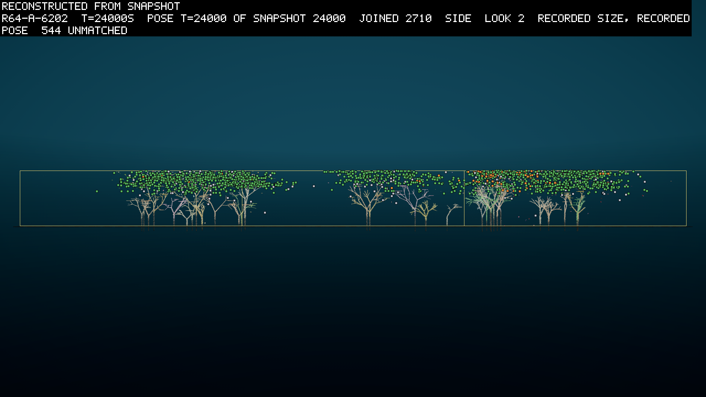
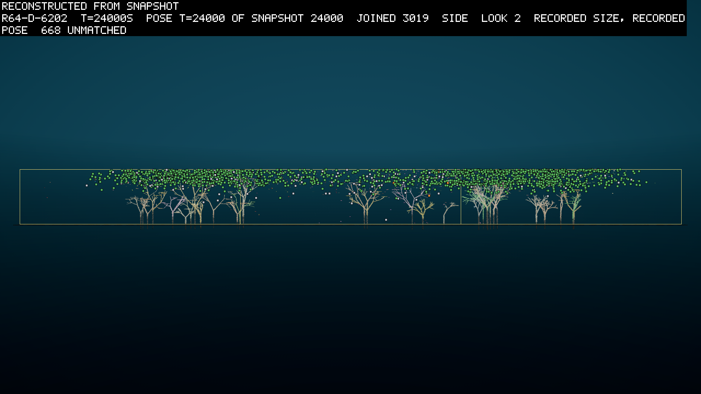
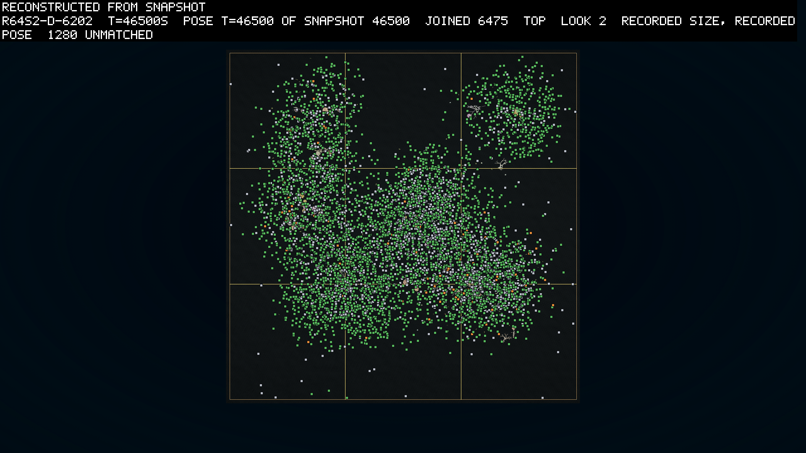

# Round 64: hard animals end the killing, and grazers boom beside living leaves

*2026-10-31, written by the writing lane from the committed reads, the day round 64's last step ended. The pre-registrations are in `logbook/specs/r64-prereg/`, and the reads are the README files of r64-read and r64s2-read beside it. Every figure is measured unless it says otherwise.*

Round 64 is phase 1 of the owner's plan to overpower grazers (D264). It made animals ten times as hard to kill and
plants five times as easy, gave newborns more of their parent's reserve, and spread the young further from their
family. Making animals hard to kill ended the grazers' habit of eating each other, and then the grazers starved young
instead. One world, with all three levers on, was carried on from 24,000 s to 48,000 s. There, for the first time in
the project, grazers boomed and stayed boomed, about 2,600 of them, with the leaves alive beside them. But the grazers
did not hold the leaves down. The leaves rose and fell with the seasons and climbed year on year, and a grazer still
took about two-fifths of its food from animals and remains.

## Why animals had to be harder to kill

Round 63 left grazers plentiful and living largely on each other (logbook/0148). The coordinator's reading, which
became D264's reason, was that the world paid more for a sibling than for a leaf. A mouth bites whatever it touches,
and one contact can kill. A bite takes a share of the victim's reserve, which in an animal is concentrated. And the
young start within 5 m of their family, so a grazer's nearest meal is often a relative. The owner's view was that
plants should live easy and die easy, and animals be much harder to kill. Then grazers would boom until they
endangered the plants, and the two would come to balance each other. The values were set to overshoot (D262).

## The screen at 24,000 s

Five worlds were founded on seed 6202 in one card group from 20:23 to 23:26 UTC on 2026-10-30
(`logbook/specs/r64-prereg/predictions.md`). Every arm was the world of arm D in round 63's screen r63h, with mouths
at a hundredth of their price, and that run was the control. Arm A made every part of an animal ten times as tough and
every part of a plant a fifth as tough. A plant, here, is any body with a photosynthetic part. Arm B gave newborns 0.8
of their share of the parent's reserve instead of 0.5. Arm C spread the young over 30 m instead of 5 m. D did all
three, and E was D with mouths at ten times that price, a tenth of the original. First, with every new switch off, the
build matched `r63h`'s worlds row for row over 600 s, so the control was this build's world.

The pre-registration set five marks. Grazers should number twice the control's, and take at least 0.8 of their bite
income from living plants. Kills should be at most a quarter of grazer deaths. The leaves should be pushed to half the
film world's but never under 500, and stop growing. A sixth asked whether spreading the young spared kin.

The table gives each arm against each mark. Bold is a pass.

| Mark | Bar | Control | A | B | C | D | E |
|---|---|---|---|---|---|---|---|
| 1. Grazers boom | at least 1,956 over the last 3,000 s | 978 | 1,003 | 1,471 | 862 | 1,255 | 338 |
| 2. Grazers graze | leaf share of bite income at least 0.8 | 0.38 | 0.63 | 0.33 | 0.46 | 0.59 | **0.84** |
| 3. Not each other's food | kills at most 0.25 of grazer deaths | 0.55 | **0.06** | 0.58 | 0.30 | **0.07** | **0.01** |
| 4. Plants pushed and alive | leaves at most 4,388 at the end, at least 500 after 3,000 s | 3,008, 920 | **2,081, 709** | **3,568, 838** | **3,336, 1,377** | **2,430, 897** | **3,432, 956** |
| 5. Leaves stop growing | late over middle mean at most 1.0 | 1.18 | 1.01 | 1.51 | **0.88** | **0.72** | 1.11 |
| 6. Kin spared (C, D, E) | close kin at most 0.08 of grazer-on-grazer kills | 0.135 | 0.12 | 0.14 | **0.04** | **0.04** | 0.10 |

No arm passed marks 1 to 5. Hard animals ended the killing. Being eaten fell from 55% of grazer deaths in the control
to 6% in A, 7% in D and 1% in E. Provisioning alone left the killing where it was, and spreading alone halved it.
Close kin fell to 4% of grazer-on-grazer kills wherever the young were spread.

Then the grazers starved young. With almost nothing eating them, starvation took half of A's grazer deaths, at a
median age of 256 s. It took 60% of D's at 333 s, and 88% of E's at 144 s. A grazer that was no longer eaten in its
first minutes now died of hunger in them. Provisioning at 0.8 did not save D's young, so the reserve was not the
limit. The read's guess is that a newborn is too far from a leaf it can reach, or its brain does not steer there.

Grazers in A and D still took about a third of their bite income from other living bodies, while kills were rare. A
bite on an animal ten times as tough wounds and feeds without killing. The read's phrase for it is that grazers had
become each other's parasites rather than each other's prey (inference, from the income split beside the kill share).

E's grazers grazed best of any world yet, its lineages taking 0.78 to 0.90 of their income from leaves. At ten times
the mouth's price they were also the fewest, 338, and most died within minutes of birth.

D was the arm the owner had asked to see. Its grazers' mean over each 3,000 s window from 6,000 s ran 88, 196, 242,
374, 709 and 1,255, doubling every window at the end. Its leaves ended at 0.28 of the film world's and fell in their
late window. Grazers had been the leaves' largest killer in three of the last four bins. It failed marks 1 and 2 at
24,000 s only because it had not finished rising.

The theatre lane drew A and D from the side at 24,000 s, from the runs' saved poses at their recorded sizes. Green
squares are leaves, and the pale branching shapes are the reef's fixed rock. A holds three sparse crowds under the
surface, with gaps between them, and its orange bodies gather in the right-hand crowd. D is one thin sheet across the
whole square, with no gap between the thirds and almost no orange. D spread every newborn over 30 m and A did not, and
an even sheet is what that spreading would make (inference). Each frame leaves out about a sixth of its world's
bodies, which the drawing could not match.

## D carried on

So D was carried on toward 48,000 s, with A beside it, since a card group needs two worlds
(`logbook/specs/r64-prereg/step2.md`). Its prediction was a crash: grazers past 1,956 by 30,000 s, the leaves under
1,500, then a swing of grazers and plants chasing each other.

That is not what came. D's grazers passed the boom mark at 33,000 s and reached a window mean of 2,630 at
42,000-45,000 s, 2.7 times the control's. The leaves never fell below 1,686. They swung on a period of 6,000 s, this
world's year, and each peak was higher than the last: 6,373, then 7,322, then 8,165 leaves. The grazers' numbers
wobbled in time with the leaves', with no lag. A grazer-and-plant cycle would show the grazers lagging the leaves, so
the swing is the seasons and not a chase (inference, at a resolution of 3,000 s). D passed marks 1, 3 and 4 of the
step, and failed mark 2 at 0.58 of bite income from leaves.

The picture shows D from above at 46,500 s, its last checkpoint of the step, drawn the same way. The leaves cover most
of the square loosely. They make one mass and a separate crowd at top right, the shape the film world had reached by
48,000 s (logbook/0148), but much thinner. Pale squares lie mixed all through the green, and a few lie out in the open
water. The theatre lane reads them as mostly grazers, from their colour and the run's counts, and did not check them
body by body. The frame draws 6,475 bodies and leaves out 1,280.

The step had a second story. At 02:44:59 UTC on 2026-10-31 the graphics driver logged an error. Thirteen seconds later
the card group's watch stopped the run, as it is built to. D's last checkpoint was at 46,500 s. The owner ruled that
card runs resume only after the theatre had rendered once alone, to see whether its shader was the cause. After that
render, step 3 ran D's last 1,500 s twice, from that checkpoint, as two worlds in one group
(`logbook/specs/r64-prereg/step3.md`). Both reached 48,000 s that morning, and the coordinator reported the two copies
equal row for row. No read of the step is committed yet. It is a cheap check I like: a world run beside itself, so
that a card computing two identical worlds differently would show it at once.

## What it changes

Phase 1 removed the cannibal economy and uncovered the problem under it, which is the newborn that cannot find its
first meal in time. The grazers have boomed, and the plants live. But the leaves climb year on year, and a grazer
still takes 42% of its income from animals and remains, against the 20% or less the mark allows. In the owner's terms,
grazers have boomed but do not yet endanger the plants.

D's world, at its checkpoint of 46,500 s or carried to 48,000 s, is the candidate world for the next screens. On
2026-10-31 the owner ruled that the leaves' smell drift with the water on a coarse grid, and that every part feel
which way the water runs (D270). A grazer could then find leaves rather than its neighbours. An anchoring cell that
lets any body hold on to the rock (D268) is built, behind a switch, and waits on a world where grips can form.