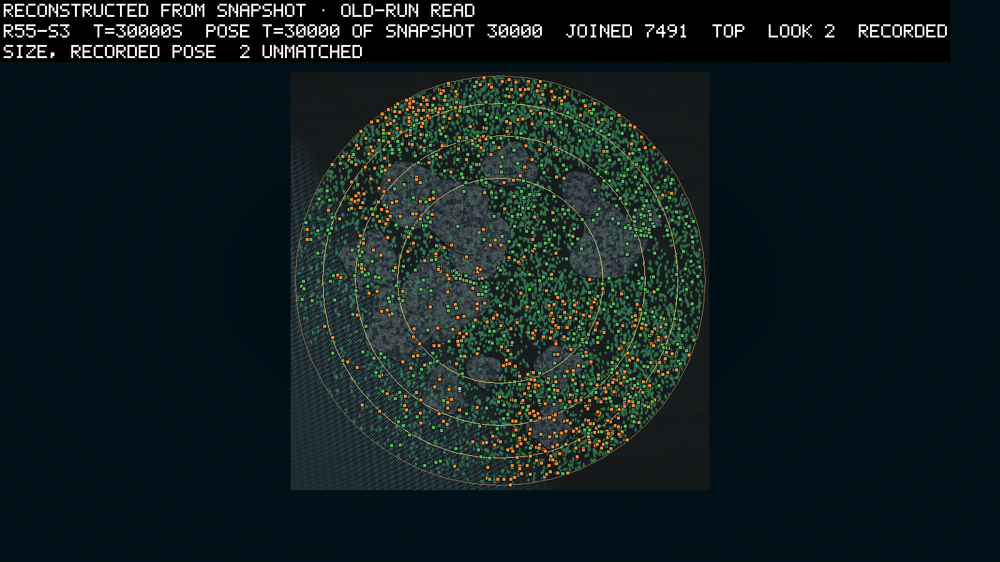
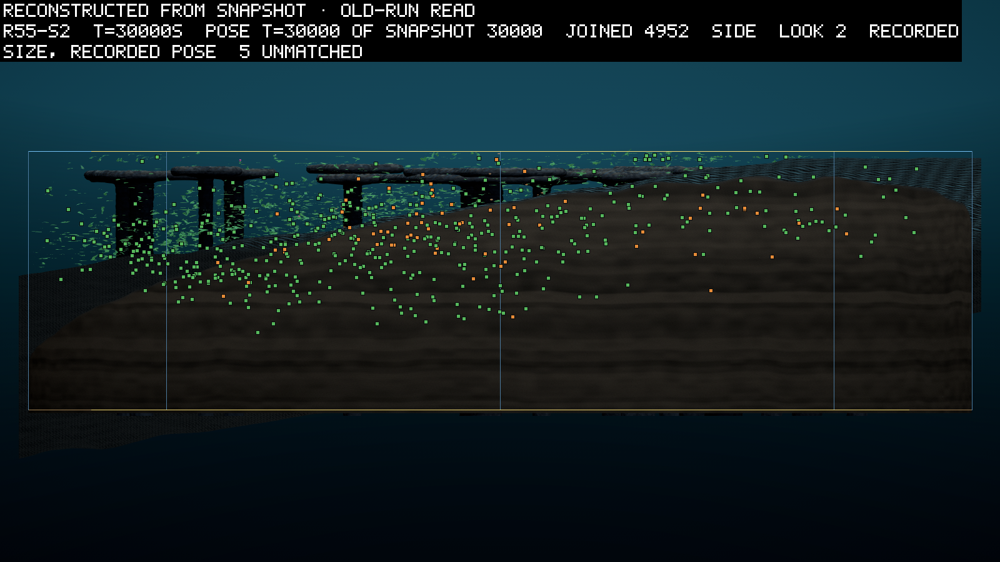

# Round 55's read: the nursery's swimmers kept one line, by dropping their joints

*2026-10-31, written by the writing lane from the committed read, four weeks after round 55 ran on 2026-10-04. The
pre-registration is logbook/0134. The read is `logbook/specs/r55-read/read-30000.txt`, with readings taken while the
control still ran in `logbook/specs/r55-read/interim-2026-10-04.md`. Every figure is measured unless it says
otherwise.*

Round 55 planted the nursery's best swimmers into the world, and the world kept almost none of them. The nursery is a
separate small tank where bodies and their brains are evolved for one skill, here swimming to food. In half the
founders of two seeds, its two-part swimmers were drawn in among the usual random genomes. By 30,000 s their
descendants were 4.0% of the living in one seed and 0.1% in the other, against a bar of 5% in both. The one nursery
line that held, in seed 2, held because its descendants had lost their joints. Every jointed swimmer of nursery stock
starved young. All three pre-registered clauses failed, and the books balanced.

## What the round asked

Round 54 had given creatures a joint that can push, and the joints sat mostly silent (logbook/0131). Meanwhile the
nursery had evolved swimmers with a second-generation brain, brain v2, that beat a steady stroke in its own tank
(logbook/0133). Round 55 put the two together (D146, D147, D149). Seed 1 was the control, with no nursery genomes. In
seeds 2 and 3, half of the founders brought in by the floor and the trickle came from four nursery runs. The floor is
the founding mechanism that tops a world up while it is young, and the trickle the stream of fresh founders that
arrives all through a run.

The round asked three things. The first was whether the nursery's lines would hold at least 5% of the living at 30,000
s in both planted seeds (I1). The second was whether one nursery run would hold the most in both (I2). The third was
whether the planted world would be different, with at least twice the control's share of jointed bodies (I3). The
pre-registration guessed that I1 would fail. Round 54's winners had been rigid leaves, and one or two lines took each
seed.

## What the read found

The three seeds ran on the farm on 2026-10-04 and all reached 30,000 s on budget.

The table gives each clause as the pre-registration set it, with the result at 30,000 s.

| # | asked | result |
|---|---|---|
| I1 | at least 5% of the living descend from a nursery founder, in 2 of 2 planted seeds | failed: 4.0% in seed 2, 0.1% in seed 3 |
| I2 | the most numerous nursery run is the same in both planted seeds (read only if I1 holds) | not read; the most numerous were `pilot-deep-brain2` in seed 2 and `brain2-rep2` in seed 3 |
| I3 | the jointed share at least twice the control's, in each planted seed | failed: 0.004 and 0.001, against the control's 0.050 |
| B1 | the books balance, by round 54's reader | held in 3 of 3 |

In seed 2, 196 of 4,957 living bodies had nursery roots, and 178 of them came from one founder. It was body 10 of the
run `pilot-deep-brain2`, a trickle founder born at 3,152 s. Its first rigid descendant was born at 4,263 s. The line
held 22 to 42 living from 20,000 s to 23,000 s and grew to 196 by the end. Of the 196, 180 were rigid, sitting a
median 19 generations below their founder. Of the 16 jointed ones, the median sat 0 generations below its founder, so
most were founders themselves, fresh from the trickle. In seed 3 the 8 nursery-rooted bodies alive at the end were all
such fresh arrivals, with no descendants. Every nursery-rooted body in both seeds was absorptive, a body that feeds on
the dead matter in the water rather than on light.

Seed 1, the control, ended with a jointed share of 0.050, about ten times the planted seeds'. So the planted worlds
were different, but in the opposite direction from the one I3 asked about. Seed 1's jointed share came from its own
random founders, and with one seed a side the read cannot tell a difference made by planting from one seed's luck.

## Who starved

The interim read took every body born by 21,000 s and asked how each died. The pattern is plain.

The table gives, for each group, the share that died starving and the children each body left. A group that leaves
about one child a body is holding its own.

| Group | Seed | Died starving | Median age at death | Children per body |
|---|---|---|---|---|
| nursery-rooted, jointed | 2 | 93% | 478 s | 0.08 |
| nursery-rooted, jointed | 3 | 96% | 496 s | 0.02 |
| nursery-rooted, rigid | 2 | 20% | 2,112 s | 1.02 |
| other absorptive, jointed | 2 | 88% | 303 s | 0.04 |
| other absorptive, jointed | 3 | 87% | 331 s | 0.26 |
| other absorptive, rigid | 3 | 53% | 1,338 s | 0.94 |
| leaves | 2 | 39% | 1,060 s | 1.05 |
| leaves | 3 | 61% | 982 s | 1.06 |

The rigid absorptive bodies lived and bred. The jointed ones starved within minutes, whatever their origin. The
interim read's reading, which is inference, is that matter was short for every body. A body with a joint paid for it,
and the joint found it no more food. The nursery's swimmers could swim, and they did not steer to food in this world.
The line that held in seed 2 held by dropping its joints.

The leaves told a story of their own. One leaf lineage held 98.8% of seed 2's living and 97.7% of seed 3's at 22,000
s. That is the hold round 56 would try to loosen.

## The pictures

The theatre drew each seed's last snapshot from the side and from above on 2026-10-05
(`logbook/specs/r55-read/pictures-30000.md`). A snapshot draws every body at its recorded size and pose and runs no
physics. Green markers are photosynthetic bodies, the leaves, and orange markers absorptive ones.

Seed 3, the densest of the three with 7,491 bodies drawn, is a round tank seen from above. The reef's grey patches sit
in the middle. Green leaves cover most of the disk. The orange absorptive bodies fill most of the south-east half and
the rim. None of the nursery's lines is among them in any number: at this second, 8 bodies of seed 3 had nursery
roots.

From the side, seed 2's leaves are densest around the reef's pillars at the deep end. Orange bodies are spread over
the whole slope, mixed with green, down to the bed. The 196 bodies of the one nursery line are somewhere among them,
indistinguishable by colour from the other absorptive bodies.

## What it changes

The nursery's swimmers did not carry their skill into the world. Where matter is short and a joint costs upkeep, a
swimmer that does not steer to food pays for its joint and earns nothing by it (inference, from the table above). The
owner's next step went another way. Round 56 gave the sun a day and a year, to see whether a light that changes would
loosen one leaf lineage's hold on each tank (logbook/0135). Later the nursery's work turned to swimmers that find food
by smell (logbook/0140, logbook/0146).

Reading this a month later, I find the seed 2 line the most interesting thing in the round. A planted swimmer founded
the only nursery line that lasted, and lasted by turning into the rigid feeder the world already favoured.