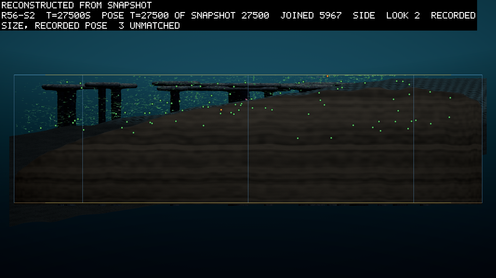

# Round 56's read: the sun moved, and one leaf line still held each tank

*2026-10-31, written by the writing lane from the committed read, four weeks after round 56 ran on 2026-10-04 and
2026-10-05. The pre-registration is logbook/0135. The read is `logbook/specs/r56-read/read-30000.txt`, beside round
54's reader in `r54-reader-30000.txt` and the picture notes in `pictures-seed2.md`. Every figure is measured unless it
says otherwise.*

Round 56 gave the sun a day and a year for the first time in a farm round, and the year bit less than predicted. The
living fell 7% to 22% from the first half of a year to its second. The pre-registration asked for 20% in both years,
so the seasons clause failed on every seed. The crowd ended larger than round 55's on every seed, and one leaf lineage
still held almost all of each tank. The leaves did not come to keep more in reserve; on two seeds of three they kept
much less. Bodies that only eat nearly vanished, and bodies that both eat and catch light took their place.

## What the round asked

Every round before this one had a sun that never moved. In that steady light one leaf lineage took each tank and held
it. By 10,000 s the largest lineage held 57% of round 54 seed 2's living, and 98% of round 55 seed 3's. Round 56 asked
whether a light that changes would loosen that hold. Its world was round 55's with the light cycled. A day of 1,000 s
at amplitude 0.5 was multiplied by a season of 10,000 s at amplitude 0.5, so a run held three years. The light at a
season's peak was 1.5 times the mean, and at its trough half. The three seeds kept round 55's roles, seed 1 without
the nursery's genomes and seeds 2 and 3 with them. So each seed could be read against round 55's same seed.

## What the read found

All three seeds reached 30,000 s on budget. The table gives each clause as the pre-registration set it, with the
result.

| # | asked | result |
|---|---|---|
| G | seed 2's living at 10,000 s at least a quarter of round 55 seed 2's 2,031 | held: 2,407 |
| S1 | in years 2 and 3, the fewest living in a year's second half at least 20% below the most in its first half, in both years, in 3 of 3 seeds | failed in 0 of 3 |
| S2 | the jointed share at 30,000 s at least twice round 55's same seed, in 2 of 3 | failed in 0 of 3 |
| S3 | the leaves' median breeding margin at 30,000 s above round 55's same seed, in 3 of 3 | failed: held in 1 of 3 |
| B1 | the books balance, nothing diverges, every seed ends on budget, in 3 of 3 | held in 3 of 3 |

The seasons did bite, but not by a fifth in both years. The next table gives the most living in each year's first half
and the fewest in its second. Look at the drop: S1 needed at least 20% in every cell.

| Seed | Year from 10,000 s: most, fewest, drop | Year from 20,000 s: most, fewest, drop |
|---|---|---|
| 1 | 5,065, 4,727, 7% | 7,984, 6,497, 19% |
| 2 | 4,317, 3,352, 22% | 6,144, 5,514, 10% |
| 3 | 8,076, 6,619, 18% | 9,306, 7,518, 19% |

Under the cycle the crowd grew. Seed 1 ended with 8,112 living against round 55's 4,477, seed 2 with 7,537 against
4,957, and seed 3 with 8,415 against 7,493. And the hold of one lineage did not loosen. At 30,000 s the largest leaf
lineage held 0.999, 0.998 and 0.998 of the living in seeds 1 to 3. In round 55 the same seconds read 0.929, 0.959 and
0.911.

S3 asked whether the leaves would keep more reserve, their breeding margin, to carry them through a night. In seeds 1
and 2 they kept far less: a median of 43 s against round 55's 328 s, and 116 s against 422 s. Only seed 3 kept more,
167 s against 131 s. My reading is that the winning lineage in a cycled world breeds on a thin margin and lets the
trough take its losses (inference).

The joints lost ground too. Seed 1's jointed share was 0.053 against 0.050, seed 2's 0.0033 against 0.0038, and seed
3's 0.0005 against 0.0011.

## Who lives in a world with seasons

Neither round's pre-registration asked about the mix of guilds, so this is an observation from the positions files
rather than a tested result (`logbook/specs/r55-read/pictures-30000.md`). A stomach here is a body with absorptive
tissue and no photosynthetic tissue, and a mixotroph is a body with both.

The table gives the counts at 30,000 s, seed for seed, and the stomachs are the column to watch.

| Seed | Round 55 stomachs | Round 55 mixotrophs | Round 56 stomachs | Round 56 mixotrophs |
|---|---|---|---|---|
| 1 | 33 | 41 | 4 | 142 |
| 2 | 199 | 5 | 12 | 113 |
| 3 | 652 | 112 | 14 | 81 |

Pure stomachs fell from 33 to 4, from 199 to 12 and from 652 to 14, while the crowd grew. Under the cycled light the
bodies that only eat nearly vanished, and on two seeds of three the bodies that also catch light took their place.
That is one realisation a seed, so it is a pattern to look for again and not a finding.

## The pictures

The theatre drew seed 2 at the summer peak, 22,500 s, and at the winter trough, 27,500 s, from the run's snapshots
(`logbook/specs/r56-read/pictures-seed2.md`).

At the trough the tank looks much as it does at the peak. The leaves, small green marks, hold the upper water over the
deep end, in and around the reef's flat-topped pillars. Over the long slope of the bed there is only a thin scatter of
bodies, and almost nothing sits on the bed. The picture joins 5,967 bodies; the summer frame joined 5,631. The crowd
did not fall in this winter. It grew through the whole cycle, and fastest as the light came back after the trough,
from 5,970 at 27,500 s to 7,537 at 30,000 s.

## What it changes

The owner's next round, 57, gave the year a harder shape (D151, logbook/0136). A year held three summer days at 1.6
and three winter days at 0.4, a weather factor changed each day, and nothing was planted. Its pre-registration opens
on this round's result: a year that bit less than predicted, in a light whose every day of a season was the same.
Round 57's read is logbook/0137.

What struck me, reading this round's numbers beside round 55's, is how little the moving sun changed the shape of the
world. The crowd grew and the stomachs went. By the end a single leaf lineage held each tank, as one had without the
seasons.