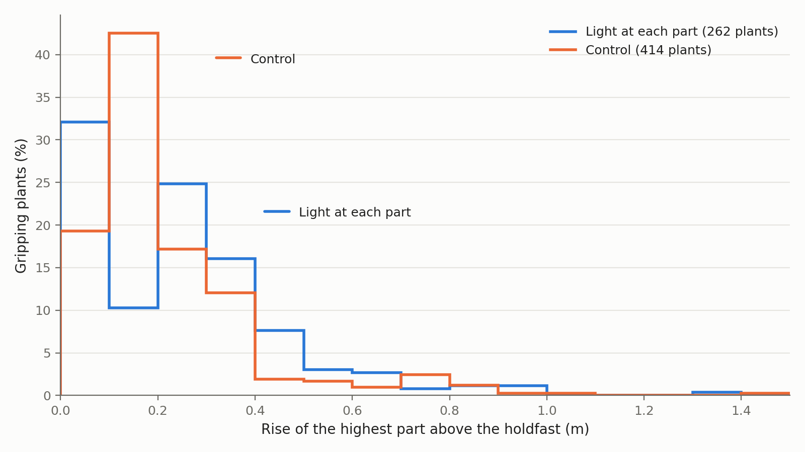

# 0160 — Light at each part did not help the forest, and gripping plants grew no taller

**2026-11-07**  ·  The plant work: the forest test, from the first forest run to D325's screen

For two days we tried to grow a forest of plants that grip the coral of the world's islands. The winter broke every
forest until a plant could rest through it, and even then a forest held on one seed in two. The owner then turned on
light and matter at each part ([D325](../DECISIONS.md#d325)), so that a taller plant would earn more. A forest held on
one seed in four, as it did without the rule, and the gripping plants stood no taller. The median one is a holdfast
and one blade, the blade a quarter of a metre above the holdfast. I think they cannot grow because the rule that adds
a blade refuses most of its tries for the body's shape. On round 67's world most of those refusals were a fault, now
fixed behind a switch. Why the fixed rule still refuses most tries has not yet been counted by cause.

## What the forest test asks

In round 66's world the plants drifted at mid-depth as single blades, and the owner asked for them to grow. The
coordinator answered with three rules under the owner's delegation
([spec](specs/plants-hold/spec.md)). A holdfast grips rock ([D296](../DECISIONS.md#d296)). Each part of a body earns
light and draws matter where it stands ([D297](../DECISIONS.md#d297)). A bitten blade frees its place, so the plant
can grow it again ([D298](../DECISIONS.md#d298)).

A holdfast is a root part made of the anchoring cell, a tissue that holds the rock it touches with a spring. Half the
plant founders start with one, set on an island's coral. An island here is one of the world's oases, where coral stands
for a holdfast to grip, and not the key's group of touching bodies. A smoke is a short run that checks a new rule
works. The anchored founders' smoke showed that a holdfast on coral grips
([anchor-smoke.md](specs/plants-hold/anchor-smoke.md)). But every child was placed in open water, so the stand lasted
one generation. The owner then ruled that a gripping plant's child settles, placed holdfast down on rock within its
parent's reach ([D307](../DECISIONS.md#d307)).

Every run in the first table below is a pair of worlds, seeds 6202 and 6203, run on the card for 12,000 simulated seconds. The test,
fixed before the first run, asks two things at 12,000 s. One island's coral must carry at least 20 living gripping
plants. At least four in five of them must be born after 3,000 s, so that the stand renewed itself rather than being
its founders grown old. The world has two seasons ([D151](../DECISIONS.md#d151)). Summer brings 1.6 times the year's
mean light and winter 0.4 times, in spans of 3,000 s after a first summer of 2,750 s. Every run is in [forest-run.md](specs/plants-hold/forest-run.md).

## The winter took every stand until a plant could rest

The first run, on 2026-11-06, found no forest. At 12,000 s seed 6202 had no gripping plant and 6203 had one. Settled
children did grip, but most were set below their parent, a median 4.5 m below on 6202, because the coral within reach
runs down the island's flanks. Light falls to a fifth by 9 m, and below that a plant starves in a few hundred seconds. Of the children set more than 3 m below their parent on 6202, 79 of 81 starved.

On 6202 the settled children still grew a second stand in the second summer, 38 gripping plants at 8,500 s. All 38 died as the light fell, 36 of them starved.
The table gives every run in order.

| Run | What changed | Most gripping on one island at 12,000 s, 6202 and 6203 | Test |
|---|---|---|---|
| First (`plf`) | D307's settling and D298's regrowth | 0 and 1, in the whole world | fails |
| Second (`plg`) | a child no deeper than its parent, a founder no deeper than 9 m ([D315](../DECISIONS.md#d315)); taller coral ([D316](../DECISIONS.md#d316)) | 2 and 1, in the whole world | fails |
| No winter (`plw`), a diagnostic | the season's swing at 0 | 25 and 26 | passes on both |
| Winter at 0.8 of the mean light (`plv2`) | [D318](../DECISIONS.md#d318)'s first step | 46 and 18 | passes on 6202 |
| Winter at 0.6 (`plv4`) | D318's second step | 21 and 5 | passes on 6202 |
| The bank (`plb`) | [D319](../DECISIONS.md#d319)'s bank | 5 and 0, in the whole world | fails |
| The rest at a 600 s delay (`plr`, `plrk`, `plro`) | D319's rest, three arms | at most 10, in the whole world | fails on every arm |
| The rest at 150 s (`pld`) | [D323](../DECISIONS.md#d323) | 28 and 12 | passes on 6202 |
| The rest across 100 to 600 s (`pldr`) | D323 | 74 and 8 | passes on 6202 |

The second run kept its plants shallower, but 77 % and 89 % of its settling children found no spot. In each winter
about twice as many gripping plants died as began. Without the winter a forest held on both seeds, so the winter had
stopped the second run.

The bank gave each anchored founder a reserve of 3,000 s of its upkeep to keep back when it breeds. Its plants hardly
bred, and its stands never grew. The rest slows a plant whose income has stood below its upkeep for longer than its
delay. Its upkeep, income and ageing run at a twentieth until its income could pay its way again. At a delay of 600 s
one gripping plant in twenty rested, and most of the others starved first. At 150 s, 148 of 522 rested, and the stand
held on 6202.

## Light at each part did not help

Until D325 a body earned light at its centre's depth, so a gripping plant found no brighter light by growing taller.
On 2026-11-07 the owner ruled D325 on the coordinator's recommendation: the forest world, with the rest across 100 to
600 s, runs with D297 on.

The smoke passed, and the screen ran four seeds, 6202 to 6205, against controls without the rule. At 14:57 the group's
heat stop fired at 99 °C, with another project's render on the cores beside it. Every world had written a checkpoint,
the saved state a run restarts from. They resumed at 15:00 and all ended at 12,000 s at 16:11. The
passage written before the screen had warned that 12,000 s, about six lives of a gripping plant, might be too short
for height to evolve.

The table shows the most gripping plants on one island at 12,000 s.

| Seed | Light at each part | Passes | Control | Passes |
|---|---|---|---|---|
| 6202 | 7 | no | 74 | yes |
| 6203 | 5 | no | 8 | no |
| 6204 | 23, all born after 3,000 s | yes | 11 | no |
| 6205 | 5 | no | 4 | no |

The rule passes on one seed of four, as its controls do. D297 changes what every body earns from the first step, so
each world is its own realisation, one roll of the dice. So the fall from 74 to 7 on 6202 cannot be laid on the rule
alone. I think part of it is the new roll, and four seeds cannot say how much. The worlds with the rule held more
bodies on three seeds.

## The plants stand a hand's breadth off the rock

No run records a part's height. A census restored each world at 3,000, 6,000, 9,000 and 12,000 s and read where every
part stood ([height-read](specs/plants-hold/height-read/)). The rise is the highest part's centre above the
holdfast's. The table pools the four seeds after 3,000 s.

| Arm | Gripping plants read | Median parts | Median rise | Rise 0.5 m or more | Rise 1 m or more |
|---|---|---|---|---|---|
| Light at each part | 262 | 2 | 0.24 m | 9 % | 0 % |
| Control | 414 | 2 | 0.16 m | 7 % | 0 % |

Three readings in both arms rose a metre or more, the highest 1.48 m, a control. The drifting plants, about 13,000
read in each arm, lie flat with all their parts at one height. Our reading, untested, is that light at each part paid
the plants that already stood shallow, so the worlds held more bodies but no taller plants. A plant cannot rise without adding blades, and the rule
that adds them refused nearly every try.

## Most of the shape refusals were a node that could never grow

A genome here is a graph of nodes, each a kind of part, and development grows the body by following its edges from the
root. A node can be indeterminate, D106's module gene, which lets a body add copies of that part while it is rich, up
to a ceiling. The module rule makes those additions. In round 67 on seed 6202 it refused 756,984 additions and let
3,659 through. A probe build resumed round 67's world from 42,000 s and counted each refusal's cause, without changing
the world ([refusal-probe.md](specs/plants-hold/refusal-probe.md)).

The limits on parts, depth and reach refused nothing. Every refusal was a body that would grow no larger, or one whose
new part would stand inside the body itself, which D101 forbids. The probe's third build found the main cause. The
rule picks its node without asking whether development ever reaches it from the root. A node never reached is dormant.
Growing it adds no part, so the body is refused at every growth step for life.

The table splits the third build's refusals by cause.

| Cause | Every body | Plants |
|---|---|---|
| The chosen node is dormant | 52.7 % | 30.1 % |
| No larger, the chosen node reachable | 36.9 % | 34.3 % |
| The body would stand inside itself (D101) | 10.5 % | 35.6 % |

A node with no path of edges back to itself occurs at most once along a path from the root. Raising its count adds no
part either, and the probe infers, without counting, that such nodes make most of the second row. Both causes are a
fault, which D298 makes agent work. The rule now picks the lowest indeterminate node that development reaches and that
lies on a cycle through itself, behind a switch that is off by default. Among plants the overlap carries about a third
of the refusals. A fix to it would change what a body may be, so it goes back to the owner.

The eight worlds of D325's screen ran with the fix on. Of every hundred tries to add a part, they refused 71 to 96 for
shape, added a few, and refused the rest for want of reserve.

## A resume on this build breaks its grips

The screen's worlds were joined across the heat stop as if a resume repeats its source. That evening a test resumed the first run's 6202 world from its 7,500 s checkpoint, on the same build and configuration. It
parted from its source at its first stats row and its first deaths. Two copies resumed together matched each other
row for row. So each joined world is the stopped run up to its stop and a cousin after it, in the key's word. The controls were stopped and resumed the same way, so the comparison stands.

A search of the checkpoint found where the parting starts. At 7,510 s the resume had formed 28 more grips than its
source and broken 28 more, with the same 22 held. So nearly every grip held at the checkpoint broke once and formed
again. The 18 bodies whose positions differ all held a grip at 7,500 s, each 1 to 2 cm higher, and no other body differs.
The plant rules' own state is written to the checkpoint and read back. No card resume with grips held had been tested
before. Our inference is that something the card's grip rule reads is wrong in the first steps after a restore.
A break needs a pull of hundreds of newtons, so it is grossly wrong. The fix is agent work, still to come.

## Open

- **The refusal probe on the fixed build** was revised before it runs, to compare each probe world with a plain
  resume rather than its source. If the overlap carries most of the plants' refusals, the overlap rule goes to the
  owner with the count. If bodies that would grow no larger carry most, the module rule has another fault.
- **The overlap rule is the owner's.** The proposal names two ways through
  ([propose-plants-grow.md](../proposals/propose-plants-grow.md), section 5). Thin blades could pass through each
  other, as kelp blades do. Or the rule could try the next node when one would overlap.
- **The brain's urge to grow** ([D308](../DECISIONS.md#d308)) waits for the probe, since it gates additions.
- **The grips at a resume** wait for their fix.
